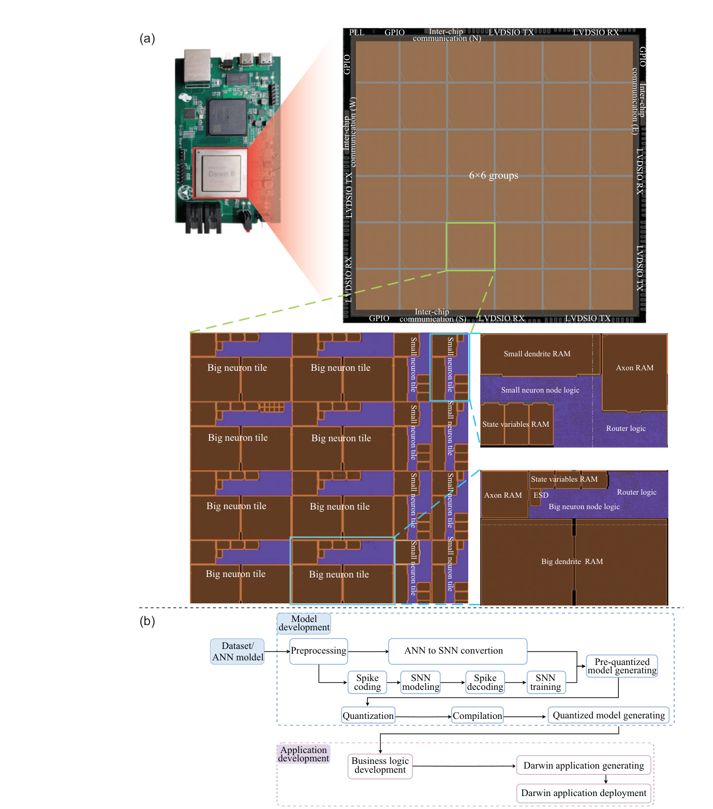
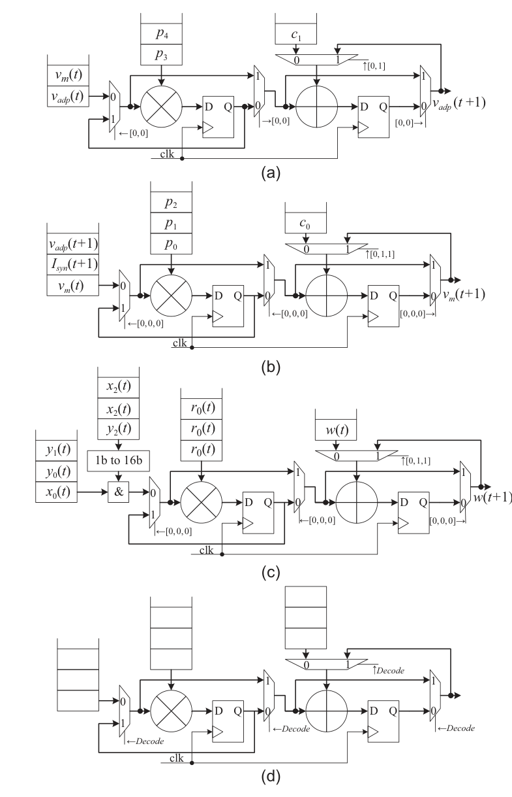
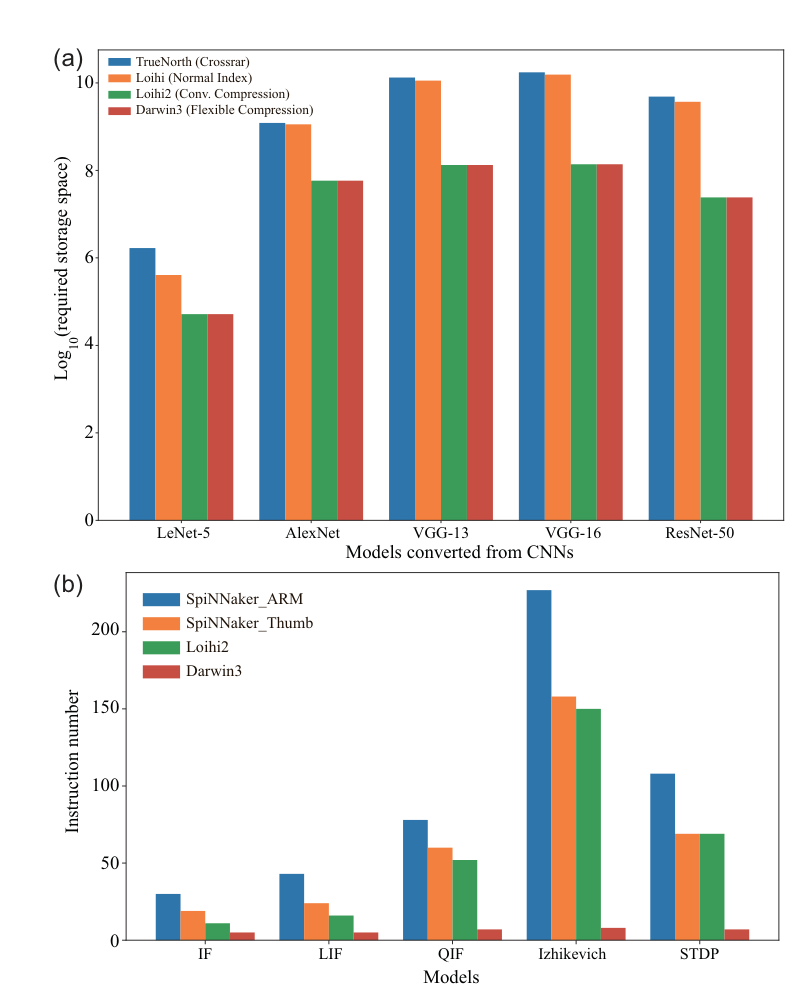
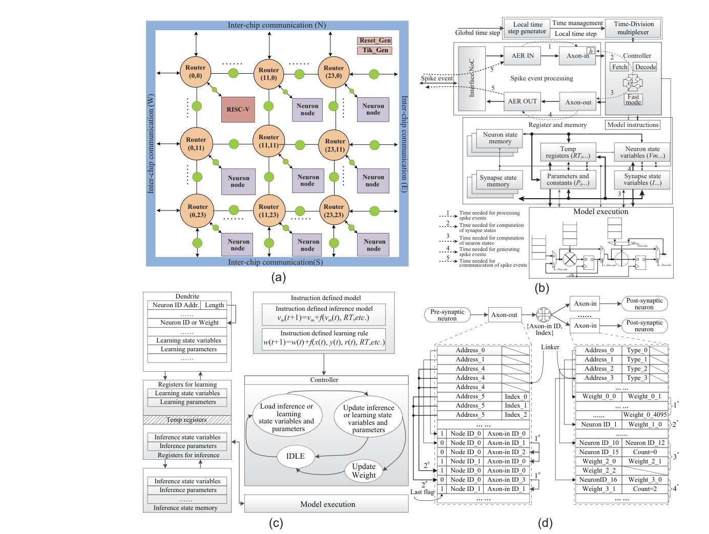
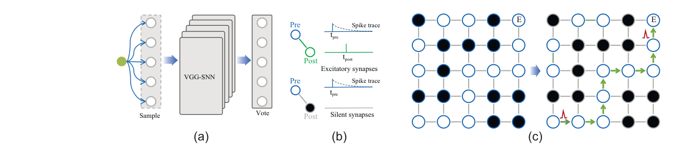

# Darwin3：面向大规模 SNN 的可编程神经形态芯片

> **论文**：De Ma, Xiaofei Jin, et al. *Darwin3: a large-scale neuromorphic chip with a novel ISA and on-chip learning*. **National Science Review**, 11(5), nwae102, 2024.  
> **原文**：[DOI: 10.1093/nsr/nwae102](https://doi.org/10.1093/nsr/nwae102) · [开放获取全文](https://pmc.ncbi.nlm.nih.gov/articles/PMC11060491/)  
> **关键词**：Neuromorphic Computing · SNN · ISA · Connectivity Compression · On-chip Learning · Mapping  
> **阅读定位**：芯片体系结构 / 软硬件协同设计论文；重点不是提出新的 SNN 训练算法，而是让不同 SNN **能够被表示、存储、部署并高效运行**。

## 1. 研究问题：为什么需要 Darwin3？

SNN 利用离散的 Spike 传递信息，理论上适合低功耗、事件驱动的计算。但“能在 PyTorch 中训练一个 SNN”与“能把它有效运行在神经形态芯片上”是两个不同的问题。

传统硬件面临三项约束：

1. **模型表达受限**：很多芯片只原生支持少数神经元模型；复杂突触动力学和学习规则难以修改。
2. **连接存储受限**：神经元之间的连接可能远多于神经元本身；权重、索引与路由表容易耗尽片上存储。
3. **学习与规模扩展受限**：片上学习规则固定，或跨 Core 的 Spike 通信及多芯片扩展成本较高。

论文的基本思路是共同设计 **SNN 专用指令、可压缩的突触连接表示、多核事件通信和学习执行机制**，并通过真实流片后的实验验证。



*图 1｜原论文 Fig. 3：上部是 Darwin3 的芯片及 FPGA 测试板；下部是 Wuyuan所描述的模型构建、量化、编译与部署流程。*

## 2. 五条最重要的学术成果

### 贡献一：利用共享计算数据通路和 SNN 专用 ISA，在可编程性与执行效率间取得平衡

**核心观点 / 成果**  
作者没有为每种神经元分别设计独立电路，而是把神经元、突触和学习规则的状态更新抽象为可复用的“乘加与状态操作”，再用一套 **SNN 领域专用 ISA** 编排执行。

**解决的痛点**  
固定功能神经元电路省资源但难以支持新模型；通用 ARM/RISC 风格指令表达灵活，却可能需要大量指令完成一次简单的膜电位更新。

**创新点**  
论文先将连续时间微分方程离散化。以膜电位更新为例，原论文 Eq. (4a) 为：

$$
v_m(t+1)=p_0v_m(t)+p_1I(t+1)+p_2v_{adp}(t+1)+c_0
$$

其中 $v_m$ 是膜电位，$I$ 是突触输入电流，$v_{adp}$ 是适应项；一次状态更新的主要工作就是取数、乘加和写回。作者发现，多种 LIF、突触动态以及 STDP 变体可以共享类似的数据通路（Fig. 1），于是设计 **10 条主要指令 + 扩展指令**：

- `LSIS / LDIP / LSLS / LDLP`：批量载入或存储推理、学习状态及参数；
- `UPTIS / UPTVM / UPTLS / UPTWT / UPTTS`：更新神经元状态、学习状态、权重和临时状态；
- `GSPRS`：阈值判断、发放与复位相关操作。

较复杂的指数、除法运算由扩展指令与移位、乘法、查找表等方式配合支持；**并不是所有数学运算都由一条原生硬件指令完成**。



*图 2｜原论文 Fig. 1：从不同状态变量的计算路径归纳到通用数据通路；右侧寄存器表未包含在裁图中，可参见论文 Table 1。*

**关键结果**  
对 IF、LIF、QIF、Izhikevich、STDP 等模型，Darwin3 在论文 Fig. 4b 的**指令数量/代码密度比较**中，相较所选 SpiNNaker 与 Loihi 2 实现报告 **2.2–28.3 倍**优势（具体取决于模型及比较对象）。Table 4 进一步展示了 LIF、RSTDP、Triplet STDP 等指令示例。

**学术意义**  
说明芯片的“通用性”并不一定要依赖通用 CPU：**识别模型共同的计算原语，再为领域定制可编程 ISA**，可以减少模型支持能力与硬件效率之间的冲突。需要注意，**指令数量减少不等于端到端执行时间按相同倍数缩短**。

### 贡献二：通过 Axon-in / Axon-out 分离与拓扑模式复用，显著提升可表示的连接密度

**核心观点 / 成果**  
Darwin3 的连接压缩不只是压缩权重数值，而是利用神经网络拓扑中的**共享、连续、群组和广播结构**，避免重复保存大量神经元索引与连接记录。

**解决的痛点**  
若每条突触都显式存储 `(source, target, weight)`，一个具有共享卷积核、全连接或群组广播结构的 SNN 可能首先耗尽连接表，而不是耗尽神经元计算资源。固定 Crossbar 则容易产生空槽位。

**创新点**  
作者为每个神经元 Core 分离设置：

- **Axon-out**：前神经元发放后，要把事件发送到哪个目标节点、引用哪个 Axon-in 入口；
- **Axon-in**：目标节点收到事件后，要激活哪些目标神经元、使用哪些权重；
- **Linker / 压缩模式**：复用多个神经元共享的连接结构，用范围起点和数量代表连续索引、用一份表表达群组关系，并支持不同精度权重。

直观理解：相同规则的 4096 条连接，不一定要分别写 4096 次目标 ID；可以保存“起点 + 数量 + 一组权重”等结构。**这种优势依赖具体拓扑是否可复用，并不等于任意稀疏图都能高倍压缩。**

**关键结果**  
在论文 Fig. 4a 的 LeNet-5、AlexNet、VGG-13/16、ResNet-50 等卷积网络映射案例中，相较论文所比较的**未采用相应专用压缩的方案**，连接/权重表示的存储开销可降低约 **6.8–200.8 倍**。论文还报告很高的有效 Fan-in / Fan-out 容量；但摘要和正文的最大提升倍数不一致，详见第 6 节的口径说明。

**学术意义**  
SNN Mapping 的容量约束不能只写“每核最多 4096 个神经元”，还应把 **Axon-in 表、Axon-out 表、权重条目、索引表示、连接类型**分别建模。可压缩拓扑与不可压缩拓扑可能具有截然不同的部署成本。



*图 3｜原论文 Fig. 4：上图比较卷积网络连接表示的存储开销，下图比较不同模型的指令数量。*

### 贡献三：以 24×24 Mesh、事件驱动 Core 和 GALS 互连构建可扩展的多核 SNN 平台

**核心观点 / 成果**  
Darwin3 把大规模 SNN 组织为**在本地更新状态、通过 NoC 交换 Spike 事件**的多核系统，并通过路由与跨芯片接口扩展神经网络规模。

**解决的痛点**  
当 SNN 被分散到许多 Core 上时，跨核 Spike 传输、路由拥塞、时间步协调和配置加载都会成为系统级开销；单纯增加“神经元数量”不足以实现可用的大网络。

**创新点**  
芯片有 $24\times24=576$ 个 Mesh 节点，其中 1 个是负责管理的 RISC-V 节点，剩余 **575 个神经元 Core**；每核按时间复用支持 **1–4096 个逻辑神经元**。Core 由控制器、模型执行、时间管理、寄存器/存储和 Spike 处理五部分构成（Fig. 2b）。系统采用 **GALS（Globally Asynchronous, Locally Synchronous）**：局部同步计算、跨模块异步通信。片上路由以 XY 为基础并引入拥塞处理策略和基于源/目的相对偏移的机制；四边有跨芯片通信接口。



*图 4｜原论文 Fig. 2：依次展示 Mesh、Core 内部执行结构、推理/学习控制和 Axon 连接表。*

**关键结果**  
由 $575\times4096$ 得到理论最大配置量 **2,355,200 个逻辑神经元**（约 235 万）。作者报告实现为 **22 nm FD-SOI** 工艺，芯片在所报告测量条件下达到 **5.47 pJ/SOP**（333 MHz、核心 0.8 V）。Fig. 5 与 Table 9 则展示了大规模网络在芯片上的运行。这里的 235 万是可支持的神经元规模，**不代表每个神经元都有一个独立的物理计算单元**。

**学术意义**  
这使 SNN 系统研究必须跨越三个层次：**神经元更新开销、跨核事件通信成本、时间步与拥塞造成的延迟**。其中 GALS 与事件通信的可扩展性，为多芯片类脑系统提供了工程基础；论文并未给出对所有负载都适用的路由最优性证明。

### 贡献四：将可编程局部学习规则纳入同一执行体系，验证真实片上 RSTDP 训练

**核心观点 / 成果**  
Darwin3 不局限于加载训练好的权重进行推理，而是允许学习阶段在芯片上根据 Spike Trace、奖励信号和可编程更新规则**改变突触权重**。

**解决的痛点**  
仅做推理的神经形态芯片需要把训练放在外部设备上；固定 STDP 更新电路又限制了实验新学习规则的空间。

**创新点**  
论文把前/后突触 Spike Trace、Reward Trace、权重和临时变量配置到寄存器与存储结构中，使用 `UPTLS` 更新学习状态、`UPTWT` 更新权重，辅以算术/分支指令组合出 Basic STDP、Triplet STDP、RSTDP、SDSP 等规则（Table 4）。

以奖励调制 STDP 为例，可以概括为：

$$
\Delta w \propto \text{Reward}\times\text{SpikeTimingCorrelation}
$$

这是**理解机制的示意式，不是论文的完整推导方程**；准确的多 Trace 更新式见原论文 Eq. (3) 与 Eq. (6)。它的含义是：前后神经元 Spike 的时间关系决定可塑性方向，而奖励/惩罚信号进一步调节权重更新。

**关键结果**  
作者基于 Diehl–Cook 风格网络添加监督奖励层，在 Darwin3 上直接用 **16-bit 权重运行 RSTDP 训练**，报告 **MNIST 96.0% 分类准确率**（Table 7，Learning Mode）。这证明了所实现的规则可以在芯片上学习，但**不是对任意梯度训练算法或任意新学习规则均可高效运行的证明**。

**学术意义**  
为“模型在计算机上训练、芯片只做执行”之外提供另一条路线：**硬件本地在线适应**。今后的研究可以比较离线训练/转换、局部学习与混合训练在精度、能耗、鲁棒性和更新次数上的差异。

### 贡献五：以流片系统、模型部署和百万神经元应用建立端到端可行性证据

**核心观点 / 成果**  
Darwin3 不只是一个 ISA 或架构模拟方案，而是有芯片、FPGA 测试板、模型工具链和应用实验相互支撑的**完整原型系统**。

**解决的痛点**  
仅报告理论神经元容量、仿真 SOP 或微基准测试，难以判断真实模型能否完成量化、映射、加载、运行并保持可接受的任务精度。

**创新点**  
论文描述了配套 **Wuyuan工具链**：对 ANN 做 SNN 转换，或直接构建 SNN，随后完成训练、量化、编译及应用封装部署。作者另外将多个 SNN 并行组成 **VGG-16 Ensemble**，以及通过 Spike 传播和 STDP 构造**迷宫寻路**应用，验证模型执行与大规模映射能力。

**关键结果**  
- **推理**：Table 8 报告多个任务/网络配置；例如 Darwin3 在 CIFAR-10 上的 Modified VGG 得到 **90.17%** 准确率、**9.88 ms** 延迟（论文表内条件）。
- **百万级模型**：5 个 VGG-16 的集成模型约 **105 万神经元**，CIFAR-10 准确率由单模型 **92.98%** 增至 **93.48%**。这证明了组合部署可行，但增益来自集成学习，不能简单归因于芯片架构。
- **迷宫任务**：Table 9 从 $63\times63$ 扩展到 $1534\times1534$ 个格点/神经元；大规模情况下 CPU 对照实现报告 `FAIL`，Darwin3 完成执行。**小规模任务中表内 CPU 实际更快**，且 CPU 对照依赖特定搜索实现，因此不应宣传为“Darwin3 普遍优于 CPU 寻路”。



*图 5｜原论文 Fig. 5：左侧是多个 VGG-SNN 的集成；右侧是基于兴奋/抑制连接与 Spike 传播的迷宫寻路。*

**学术意义**  
把 **“模型可编程” → “参数可容纳” → “连接可映射” → “芯片可运行” → “应用可验证”**串成闭环。对后续 Mapping/Compiler 研究而言，真实部署的正确性与性能测量应和算法搜索结果一起构成评价证据。

## 3. Darwin3 与 Loihi / Loihi 2：差别究竟在哪里？

以下仅比较原论文与 Intel 历史技术资料中明确给出的**设计定位与能力**，不把不同工艺、不同任务条件下的数值当成公平性能排名。

| 维度 | Darwin3（本文） | Loihi / Loihi 2 |
| --- | --- | --- |
| 核心取向 | 以 SNN 状态方程为基础设计专用 ISA，兼顾神经元更新与学习 | Loihi 支持基于 Trace 的学习；Loihi 2 强化可编程神经元和学习机制 |
| 芯片规模（单片） | 575 个神经元 Core，最高约 235 万逻辑神经元 | 原论文 Table 6：Loihi 128 Core、最多约 128K 神经元；Loihi 2 为 128 Core、最多约 100 万神经元 |
| 连接表示 | Axon-in / Axon-out 分离，并对多种共享、群组、连续连接压缩 | Loihi 采用索引/压缩，Loihi 2 同样针对卷积、因子化结构增强了连接表示 |
| 模型与学习 | ISA 描述多种神经元动力学、STDP 变体，并验证 RSTDP 片上训练 | Loihi / Loihi 2 也支持可编程的局部学习；差别是表达方式和支持的操作集合 |
| 片间扩展 | 2D Mesh、GALS、四边跨芯片通信 | Loihi 系列也提供多芯片互连，Loihi 2 加强了系统扩展能力 |
| 软件生态（历史） | 本文描述 Wuyuan 工具链；**论文没有附上可直接复现的完整公开 SDK 安装说明** | Loihi 2 曾使用 Lava 框架；截至 2026-11，Intel 的 `lava-nc/lava` 仓库已归档，不能将其视为仍持续维护的官方 SDK |

**如何理解比较？** Darwin3 的突出侧重点是 **SNN 领域专用指令 + 泛化的连接表示 + 大规模 Core 组织**；Loihi 2 在可编程神经元、卷积连接压缩和局部学习上也有成熟设计。不能把“支持 STDP”“有 Mesh”“支持卷积连接”写成 Darwin3 独有的首创功能。

参考资料：[Darwin3 原论文 Table 6](https://doi.org/10.1093/nsr/nwae102) · [Intel 发布 Loihi 2 与 Lava（2021）](https://www.intc.com/news-events/press-releases/detail/1502/intel-advances-neuromorphic-with-loihi-2-new-lava-software) · [Lava GitHub 仓库状态（2026）](https://github.com/lava-nc/lava)。

## 4. 从训练到部署：Darwin3 配套工具链在做什么？

论文 Fig. 3b 提供的是**高层工作流图**，不是逐条可执行的安装/命令文档。可将其理解为两种不同入口、同一硬件后端。

**路径 A：先离线训练，再部署推理**

```text
数据 / ANN 模型
    ↓ 预处理 / ANN→SNN 转换（或直接构建 SNN）
SNN 网络与输入 Spike 编码
    ↓ 离线训练或转换后校准
模型参数与拓扑
    ↓ 权重量化、尺度与时序参数配置
硬件可接受的 SNN 表示
    ↓ 编译：分核 / 放置 / Axon 表与路由配置 / ISA 生成
芯片配置数据
    ↓ 上位机或 FPGA 传输并加载到 Darwin3
推理执行 → 记录 Spike / 延迟 / 精度 / 功耗
```

**路径 B：在片上执行学习**

```text
网络拓扑 + 初始权重 + Spike 编码 + 学习规则
    ↓ 编译并配置 Trace、Reward、权重更新指令
Darwin3 推理与学习执行
    ↓ 收到 Spike 和 Reward 事件
片上更新 Trace 与突触权重
    ↓ 测试集评估 / 与软件基线比对
```

两条路线**不能混为一谈**：ANN→SNN 转换后的推理准确率，不能用于证明片上训练有效；论文的 MNIST 96.0% 来自真实片上 RSTDP 训练实验。文中展示了 Wuyuan 的功能流程，但并未公开所有编译器数据结构、Mapping 优化目标、可用 SDK 版本以及完整部署指令；这些细节需要从课题组提供的工具链确认。

### 编译器在硬件上至少需要处理什么？

| 阶段 | 真实约束 | 不能忽略的验证 |
| --- | --- | --- |
| Partition | 每 Core 逻辑神经元数、状态存储、Axon-in/out 容量、学习状态与权重存储 | 所有 Core 均合法，不能仅检查 neuron count |
| Placement | 575 Core 的位置、各 Core 之间的 Spike 流量、边缘通信与时序 | 映射满足芯片拓扑和地址规则 |
| Routing / Connectivity Encoding | Axon-out 目的地、Axon-in 表、连接压缩模式、不同精度权重 | 解码后的连接图与原 SNN **语义等价** |
| ISA / Schedule | 神经元模型、状态更新顺序、时间步、学习规则指令和寄存器 | 与软件参考模型进行逐时刻/逐状态对照 |
| Runtime / Evaluation | Spike 活动率、通信量、拥塞、延迟、功耗、任务精度 | 报告 workload、硬件条件与测量方法 |

这张表是**根据论文架构归纳的研究检查清单**，不是作者公开的 Wuyuan 内部模块接口定义。

## 5. 对后续 SNN Mapping / Agent / Benchmark 研究的启发

以下是基于原论文提出的**后续研究问题**，不是论文已实现的实验或现成的 Darwin3 API。

### 5.1 Mapping 应把“可装下”与“跑得快”分开

- **硬约束（Feasibility）**：每 Core 的神经元、寄存器/状态、连接条目、权重存储、精度及合法路由。
- **优化目标（Optimization）**：跨 Core Spike 数、路径长度、拥塞、延迟、能耗、有效 Core 利用率。
- **正确性检查（Correctness）**：输出 Spike 或膜电位与参考实现一致，或在预先定义的数值误差内一致。

**关键观察**：Darwin3 支持连接模式压缩，因此“突触边数相同”未必意味着“使用同样的存储”。评价器应尽可能使用编译器生成的**实际连接表占用**，而不是只统计抽象边数。

### 5.2 一个能落地的最小 Benchmark

建议先选一个小型 LIF-SNN（而非直接百万规模模型），建立以下输入与输出合同：

```text
输入：带权有向 SNN 图、神经元参数、输入 Spike Trace、Core 容量/拓扑
候选：Partition + Placement + 连接编码方案
检查：是否超容量、连接能否无损还原、模型数值是否一致
输出：合法性、Core 使用数、Axon-in/out 条目数、Global Spike 数、平均跳数
扩展：硬件/仿真有依据时再加入延迟、拥塞、能量与任务精度
```


### 5.3 三个适合后续验证的研究假设

1. **Compression-aware Mapping**：在神经元数量相同的前提下，优先聚合可共享连接模式的神经元，是否减少 Axon 表开销？
2. **Traffic-aware Placement**：以输入 Spike Trace 而非静态边数作为通信权重，是否降低实际拥塞与延迟？
3. **Training-aware Mapping**：考虑学习阶段额外的 Trace/Weight 状态、动态更新与数据搬运后，最优部署方案是否改变？

### 5.4 论文之外的系统级后续进展（2025）

浙江省经济信息中心在 [2025 年报道](https://zjic.zj.gov.cn/zkfw/szhfn/202508/t20250806_23616740.shtml) 中介绍，基于 Darwin3 芯片的 **Darwin Monkey（悟空）** 多芯片系统使用 **960 颗 Darwin3**，支持超过 **20 亿个脉冲神经元**。

## 6. 阅读时必须保留的三个边界

**① Fan-in / Fan-out 最高倍数存在论文内部口径不一致。** 摘要报告相对于物理内存深度的最大提升为 **4096× / 3072×**，但正文 p.12 的 *Synapse capacity* 段落写作 **1024× / 2048×**。二者可能对应不同配置、公式或版本，但文章没有在这两处直接给出可核对的一致解释。

**② 容量、能耗、准确率是不同层面的指标。** 约 235 万是逻辑神经元配置上限；**5.47 pJ/SOP** 来自特定两层网络测量与芯片条件；**96.0%** 是特定 RSTDP 训练任务精度。不能把三者拼接成未经验证的“所有百万级 SNN 都有相同能效和精度”。

**③ 跨芯片性能对比不是标准化等条件实验。** 论文 Table 6–8 汇总不同工艺节点、电压、位宽、模型、数据集和测试条件下的结果。作者自己的性能主张应当连同比较条件报告；其中 Loihi 2 能耗/SOP 的可比数值在原文表中缺失，不能据此推断其能耗必然高于 Darwin3。

## 7. 一句话总结

> **Darwin3 的真正贡献是围绕 SNN 的“可编程状态更新—可压缩连接—事件通信—局部学习”进行体系结构协同设计，并用流片芯片与应用验证可运行性。** 对 Mapping 研究最直接的启示，是将**真实硬件表示和约束**引入优化与评测，而不只比较算法层面的神经元数量或 Spike 总数。

---

### 文献与图片说明

- **主要来源**：Ma et al., *National Science Review*, 2024, 11(5), nwae102. [DOI](https://doi.org/10.1093/nsr/nwae102)。原文 Fig. 1/2/3/4/5、Table 2/4/6/7/8/9 与正文相应章节。
- **拓展对照**：[Intel：Loihi 2 与 Lava 发布公告](https://www.intc.com/news-events/press-releases/detail/1502/intel-advances-neuromorphic-with-loihi-2-new-lava-software)；[Intel Lava GitHub 项目（已归档）](https://github.com/lava-nc/lava)。
- **图片版权**：本页配图裁取自上述 Darwin3 论文原文，原论文为 **CC BY 4.0** 开放获取许可，作者及 DOI 已注明。图片只是裁切排版，不表示修改作者的原始实验数据。
