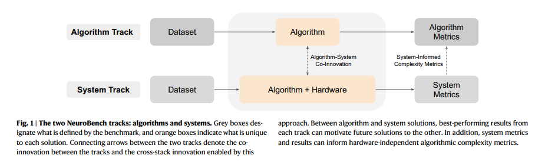
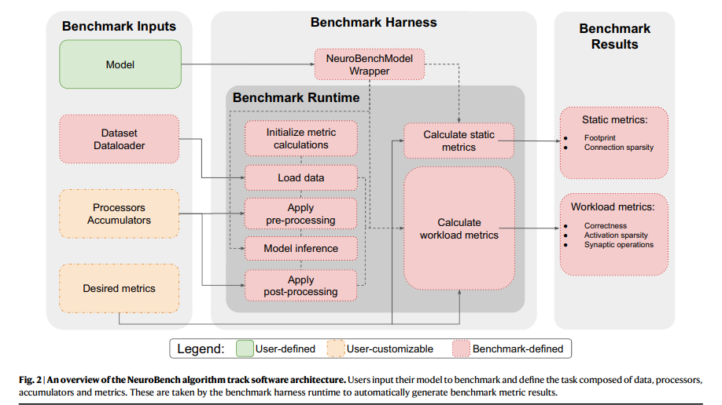

# NeuroBench：神经形态计算算法与系统的标准化评测框架

> 论文：*The NeuroBench Framework for Benchmarking Neuromorphic Computing Algorithms and Systems*  
> 发表：*Nature Communications*, 2025, 16:1545  
> DOI：[10.1038/s41467-025-56739-4](https://doi.org/10.1038/s41467-025-56739-4)  
> 论文类型：Perspective，介绍框架、评测规范与初步基准结果。

## 1. 总述

这篇论文讨论一个基础但重要的问题：**怎样公平地衡量神经形态计算方法的能力与效率，并让不同研究团队的结果能够相互比较？**

神经形态计算希望借鉴生物神经系统的计算方式，探索更高效、更适合实时处理的算法和硬件。研究方案覆盖 SNN、不同神经元模型、专用芯片以及多种软硬件组合。由于数据、模型、硬件和测量方式各不相同，单独报告模型准确率、芯片功耗或某个算子的运行时间，很难完整呈现一套方案的真实表现。

作者提出 **NeuroBench**，将基准任务、数据集、指标、测量流程和开源工具组织成一个可持续扩展的 Benchmark 框架。它包含两条互相促进的评测轨道：

- **Algorithm Track（算法轨）**：尽量独立于具体硬件，分析算法的任务表现与复杂度，适合算法研究、原型开发和方案筛选。
- **System Track（系统轨）**：把算法部署到真实硬件系统中，测量实际任务表现、运行时间、吞吐量、功耗和能耗。

整体流程可以概括为：

```text
统一任务与数据
      ↓
算法轨：评估任务表现 + 模型复杂度
      ↓
筛选值得部署的算法与工作负载
      ↓
系统轨：在真实硬件上测量时间、吞吐量与能耗
      ↓
用部署结果反过来改进算法和复杂度模型
```

两条轨道形成一个 **Algorithm-System Co-innovation** 循环：算法研究为硬件部署提供目标，系统测量为算法设计提供反馈。

论文的重点不是提出一个新的 SNN 网络或单一优化算法，而是建立一套可复用的评测方法。NeuroBench v1.0 的算法轨包含四类任务：少样本持续学习、事件相机目标检测、运动皮层信号解码和混沌时间序列预测；系统轨则包含声学场景分类与 QUBO 优化任务。

论文中的两张核心示意图值得留意：

- **第 2 页 Fig. 1**：展示算法轨与系统轨如何通过结果反馈形成协同创新。



- **第 3 页 Fig. 2**：展示算法轨的 Harness 如何把模型、数据、处理流程与指标计算组织为统一评测入口。


## 2. 重要概念辨析

### 2.1 Algorithm Track 与 System Track

两条轨道回答的问题不同，适合搭配使用。

| 维度 | Algorithm Track | System Track |
|---|---|---|
| 评测对象 | 算法与模型 | 算法部署后的完整系统 |
| 主要目的 | 分析任务表现、模型复杂度与资源需求 | 测量实际运行时间、吞吐量、功耗和能耗 |
| 运行环境 | 可在 CPU、GPU 等常规平台上模拟或执行 | 真实部署硬件及其必要的处理链路 |
| 典型指标 | Accuracy、Footprint、Sparsity、Synaptic Operations | Correctness、Timing、Power、Energy |
| 主要价值 | 快速筛选方案，指导系统设计 | 验证部署表现，反馈算法和硬件设计 |

算法轨的复杂度指标与真实硬件性能存在关联，但两者属于不同层次。较少的有效运算能够说明算法具有潜在的计算优势；实际延迟和能耗还会受到硬件架构、数据处理、存储访问与通信方式影响。

### 2.2 Task-level Benchmark：以完整任务为评价单位

Task-level Benchmark 将评价对象放在一项完整任务上，例如完成一次分类、预测或优化求解。它关注：

- 系统能否完成目标任务？
- 结果质量如何？
- 从规定的输入阶段到结果生成需要多少时间？
- 完成任务消耗多少功率和能量？

相比只测量某个算子或内核，任务级评测更容易比较内部实现不同的系统。只要任务定义、指标和测量边界清晰，结果就更容易解释。

### 2.3 Correctness、Complexity 与 System Efficiency

这三个维度分别描述任务质量、算法成本和部署效率。

- **Correctness（任务正确性）**：模型或系统完成目标任务的质量。分类任务可以使用 Accuracy，目标检测可以使用 mAP，回归任务可以使用 \(R^2\) 或误差指标。
- **Complexity（复杂度）**：算法需要多少模型存储空间、连接、激活和突触运算。
- **System Efficiency（系统效率）**：部署后实际需要多少时间、功率和能量。

三者需要结合起来理解。更小的模型可能拥有更低的资源开销，同时也可能产生任务质量上的变化；较高的稀疏度也需要结合有效运算和硬件实现进行判断。

### 2.4 Static Metrics 与 Workload Metrics

算法轨进一步把复杂度指标分成两类：

- **Static Metrics（静态指标）**：通过分析模型结构即可计算，例如 Footprint 和 Connection Sparsity。
- **Workload Metrics（工作负载指标）**：需要模型执行或模拟执行后才能统计，例如 Correctness、Activation Sparsity 和 Synaptic Operations。

结构信息适合在运行前检查，执行行为和任务表现则由统一的运行时收集。

### 2.5 Benchmark Harness：统一评测入口

Benchmark Harness 是把不同模型接入同一套评测流程的公共工具层。NeuroBench 的算法轨架构包括：

```text
Model + Dataset / Dataloader
            ↓
       Pre-processing
            ↓
       Model Inference
            ↓
       Post-processing
            ↓
       Metrics Calculation
            ↓
       Standardized Results
```

用户通过统一接口提供模型、数据和需要定制的处理组件；Harness 负责组织运行流程、计算指标并输出结果。这种结构降低了新方法接入 Benchmark 的成本，也便于扩展数据集、模型框架和评价指标。

### 2.6 为什么不只比较 Accuracy 或能耗？

单一指标容易掩盖真实的权衡：

- 只看 Accuracy，可能忽略模型大小、延迟与能耗。
- 只看 Footprint，可能忽略模型是否完成了任务。
- 只看 Activation Sparsity，可能高估稀疏计算带来的收益。
- 只看功耗，可能忽略系统为完成任务所花费的时间。
- 只看运行时间，可能忽略系统在运行期间消耗的能量。

因此，NeuroBench 不追求用一个指标概括所有方案，而是根据任务同时报告正确性、复杂度和系统效率。

## 3. 主要方法与公式

### 3.1 算法轨：用一组指标描述模型成本

NeuroBench 的算法轨使用任务正确性指标和复杂度指标共同评价模型。v1.0 的主要复杂度指标如下。

#### （1）Footprint：模型存储占用

Footprint 衡量表示模型所需的内存空间，单位为 Byte。论文将模型参数和缓冲区的大小累加：

\[
\mathrm{Footprint}
=
\sum_i p_i+\sum_j q_j
\]

其中：

- \(p_i\)：第 \(i\) 个模型参数占用的字节数；
- \(q_j\)：第 \(j\) 个缓冲区占用的字节数。

参数主要保存模型权重；缓冲区还可能保存循环网络或 SNN 的内部状态，以及为输入分箱而保留的历史数据。

要注意，**Footprint 不等于完整的运行时内存占用**。运行时可能还需要额外存放中间激活等数据。

#### （2）Connection Sparsity：连接稀疏度

连接稀疏度表示模型权重中零权重所占的比例：

\[
S_{\mathrm{conn}}
=
\frac{\text{零权重总数}}{\text{权重总数}}
\]

- \(S_{\mathrm{conn}}=0\)：没有零权重，连接完全稠密。
- \(S_{\mathrm{conn}}=1\)：所有权重均为零，连接完全稀疏。

论文的计算方式是先统计每层参数矩阵中的零权重数与总权重数，再对所有层进行汇总。该指标能够反映剪枝和稀疏网络结构带来的变化。

较高的连接稀疏度并不自动意味着部署后内存和计算量同比下降：如果硬件仍然按照稠密矩阵存储和执行，零权重仍可能占据存储空间或产生无效运算。

#### （3）Activation Sparsity：激活稀疏度

激活稀疏度衡量模型运行过程中，神经元输出为零的比例：

\[
S_{\mathrm{act}}
=
\frac{\text{所有层、时间步与样本中的零激活数}}
{\text{所有层、时间步与样本中的激活总数}}
\]

对于 ANN，零激活可以来自 ReLU 等激活函数；对于 SNN，未产生 Spike 的神经元也会形成零激活。

- \(S_{\mathrm{act}}=0\)：没有零激活。
- \(S_{\mathrm{act}}=1\)：所有被统计的激活均为零。

较高的激活稀疏度意味着运行时存在更多零输出，为潜在的计算节省提供线索，但不能直接当作真实加速比例。

#### （4）Synaptic Operations：突触运算量

Synaptic Operations（SynOps）统计模型一次前向执行中的突触运算。NeuroBench 区分三种计数方式：

- **Dense**：按稠密执行方式统计，包含零权重和零激活对应的运算，近似反映不支持稀疏计算的硬件需要执行的运算量。
- **Eff_MACs**：统计有效乘加运算，只计算非零权重与非零、非二值激活对应的有效运算。
- **Eff_ACs**：统计有效累加运算，适用于激活值为 \([-1,0,1]\) 的二值型场景，例如 SNN Spike。

可以用下面的关系理解它们：

```text
Dense SynOps
    ↓ 排除零权重与零激活
Effective SynOps
    ├── Eff_MACs：乘加运算
    └── Eff_ACs ：累加运算
```

Eff_MACs 与 Eff_ACs 对应不同的运算类型，解读结果时应保留类型信息，并结合目标硬件的实现方式进行比较。

一个重要细节是：**激活稀疏度高，实际有效运算量仍可能较高。** 例如，归一化操作若在突触权重乘法之前把零激活转化为非零值，最终统计到的有效运算就会增加；二值激活也可能被变换为非二值数据，使运算从 AC 变为 MAC。因此，Activation Sparsity 与 Synaptic Operations 适合联合分析。

论文在 Harness 中通过执行连接层来统计有效运算：将非零权重和非零激活置为 1，再执行前向计算并汇总输出；稠密运算量则通过将权重和激活都置为 1 来估计。该统计不计入连接层权重乘法与累加之外的 Bias 加法。

#### （5）Model Execution Rate：模型执行频率

Model Execution Rate 表示模型前向执行需要达到的频率，单位为 Hz。若模型处理输入的时间步长（temporal stride）为 \(T\) 秒，则：

\[
f_{\mathrm{exec}}=\frac{1}{T}
\]

例如，模型每隔 10 ms 处理一次新输入，对应：

\[
f_{\mathrm{exec}}=\frac{1}{0.01}=100\ \mathrm{Hz}
\]

需要区分 **input stride（输入步长）** 与 **bin window（输入窗口长度）**。例如输入窗口可以是 50 ms，但每隔 10 ms 就更新一次，执行频率仍是 100 Hz。执行频率由任务或模型设计者报告，并不是 Harness 自动推导的指标。

执行频率可以与单次执行的 SynOps 一起解读，帮助估算持续工作负载下的计算需求。不过，论文指出 v1.0 尚未为纯事件驱动或连续时间模型明确定义这一指标。

### 3.2 系统轨：测量真实部署表现

系统轨评估的是算法与硬件组成的整体 System Under Test（SUT），主要包括三类指标。

#### （1）Correctness：系统正确性

系统必须报告完成任务的结果质量。由于某些神经形态硬件与算法实现紧密耦合，NeuroBench v1.0 允许系统使用不同的算法，因此不强制所有系统采用完全相同的模型，也没有对所有提交统一设置正确性阈值。

为了让不同质量水平的系统仍然可以比较，官方排行榜计划按正确性设置不同等级，以呈现不同的准确率—效率权衡。

#### （2）Timing：时间表现

时间指标根据任务场景定义，主要有：

- **Offline / Batched**：批量处理输入，重点关注吞吐量。
- **Single-stream**：前一个输入完成后再处理下一个输入，重点关注单次执行时间。
- **Server**：系统可能同时处理多个请求，需要同时关注吞吐量与响应时间。
- **特殊工作负载**：对于组合优化或连续数据流等任务，可使用 time-to-solution、超过实时阈值的执行比例等专门指标。

不能脱离任务场景讨论“谁更快”。同一个系统在单次延迟和批处理吞吐量上的排名可能不同。

#### （3）Efficiency：功率与能耗

神经形态系统强调能效，因此功率与能耗是系统轨的一等指标，而不是可有可无的附加信息。

论文使用空闲功率与工作功率的差来计算动态功率：

\[
P_{\mathrm{dynamic}}
=
P_{\mathrm{active}}-P_{\mathrm{idle}}
\]

其中：

- \(P_{\mathrm{idle}}\)：系统已准备好执行任务、模型已加载，但处于空闲状态时的功率；
- \(P_{\mathrm{active}}\)：系统运行预处理或推理时的功率。

基于动态功率和执行时间，可以计算动态能耗：

\[
E_{\mathrm{dynamic}}
=
P_{\mathrm{dynamic}}\times t_{\mathrm{execution}}
\]

注意单位换算：mW × ms 得到 μJ；若需要以 mJ 表示，还需除以 1000。

测量哪些部件、是否包含主机端预处理、如何测量模拟前端功耗，都可能影响结果。NeuroBench 因此要求提交者清楚描述测量范围，而不是只给出一个脱离背景的功耗数字。

### 3.3 系统测量的关键规则

NeuroBench 对系统轨提出了几条重要原则：

1. **预处理与后处理要计入系统测量。** 对事件相机、音频等非标准数据，数据转换可能占据显著的时间和能耗，不能只测硬件推理内核。
2. **时间和能耗应结合任务定义。** 实时常开任务可能更关注平均功率；离线高吞吐任务可能同时关注峰值功率和单次推理能耗。
3. **即使分开跑性能模式和能效模式，也都要报告两类指标。** 这样可以看到系统不同配置下的取舍。
4. **测量方法需要透明。** 由于不同神经形态系统的数字/混合信号实现、板级集成和成熟度差异较大，v1.0 侧重要求报告完整方法与背景，逐步推动测量方式趋于一致。

论文第 10 页的 Fig. 6 展示了神经形态系统从单芯片边缘设备、多芯片板卡到多板服务器的不同集成规模，也解释了为什么系统轨难以用一套完全相同的功耗测量流程覆盖所有设备。

### 3.4 NeuroBench v1.0 的算法轨任务

| 任务 | 数据集 | 正确性指标 | 主要考察内容 |
|---|---|---|---|
| Keyword Few-Shot Class-Incremental Learning（FSCIL） | MSWC | Accuracy | 少样本条件下逐步学习新关键词，同时保留旧类别知识 |
| Event Camera Object Detection | Prophesee 1MP Automotive | COCO mAP | 从事件相机数据中检测车辆、行人等目标 |
| Non-human Primate Motor Prediction | Primate Reaching | \(R^2\) | 根据运动皮层记录预测指尖速度 |
| Chaotic Function Prediction | Mackey–Glass time series | sMAPE | 对混沌时间序列进行自回归预测 |

这四个任务覆盖不同数据模态与模型特点，避免 Benchmark 只对某一类网络或单一应用有效。

#### （1）Keyword FSCIL

先用大量样本训练基础类别，再通过连续的少样本学习阶段逐步引入新类别。NeuroBench 的设置包含 100 个基础关键词类别和 10 个增量阶段，每阶段增加 10 个新类别；每个新类别仅提供 5 个训练样本，最终类别总数为 200。

该任务不只测量新类别学习效果，也要观察模型对既有类别的保持能力。

#### （2）Event Camera Object Detection

使用 Prophesee 1 Megapixel 汽车检测数据集，正确性通过 COCO mAP 计算。该任务强调事件数据的时序特征，以及模型在实时边缘应用中的效率。

论文将原有 RED ANN 与替换部分 ConvLSTM 层的 Hybrid ANN-SNN 进行比较，展示模型规模与检测质量之间的取舍。

#### （3）Non-human Primate Motor Prediction

根据运动皮层数据预测二维指尖速度，使用 \(R^2\) 评估预测质量。数据来自两只非人灵长类动物的六个记录 session，采样频率为 250 Hz。该任务能够比较 ANN 与 SNN 在较小回归网络上的质量和复杂度。

#### （4）Chaotic Function Prediction

使用 Mackey–Glass 混沌时间序列，模型根据当前或历史信息预测未来值。正确性通过 sMAPE 衡量。

该任务适合测试小型网络的预测能力，并分析显式输入缓冲与隐式循环状态在复杂度、预测误差和泛化能力上的取舍。

### 3.5 NeuroBench v1.0 的系统轨任务

#### （1）Acoustic Scene Classification（ASC）

该任务根据环境音频识别场景，数据来自 DCASE 2020 数据集的四类：airport、street traffic、bus、park。每个输入样本为 1 秒音频，采用 single-stream 场景。

论文比较了：

- **CPU 基线**：Arduino Nano 33 BLE，使用 ARM Cortex-M4，同时承担预处理与 CNN 推理。
- **Xylo 基线**：SynSense Xylo 神经形态系统，使用 SNN 进行推理，并通过模拟前端把音频转换成 Spike。

论文报告两者准确率相近：CPU 为 79.64%，Xylo 为 79.90%。按各自的测量范围计算，Xylo 的动态推理功率约低 60.9 倍，动态推理能耗约低 33.4 倍。

但需要注意：CPU 结果是系统级测量，而 Xylo 的不同环节采用 component-wise 测量；Xylo 预处理使用实时模拟音频路径。比较时必须同时阅读测量边界，而不能只抄倍率结论。

#### （2）QUBO Optimization

QUBO（Quadratic Unconstrained Binary Optimization）是无约束二进制二次优化问题。NeuroBench v1.0 使用最大独立集（Maximum Independent Set, MIS）构造工作负载：在给定图中选择尽可能多的顶点，并保证任意两个被选顶点之间没有边。

Benchmark 通过图节点数、连接密度和随机种子生成工作负载，并在固定运行时间后评价解的质量与能耗。论文使用三类求解器：

- **SA（Simulated Annealing）**：模拟退火；
- **TABU（Tabu Search）**：禁忌搜索；
- **Loihi 2**：在神经形态芯片上实现并行化的模拟退火方法。

因为该任务以固定运行时间为比较条件，所以核心指标是 BKS-Gap 和功率，而不是再次比较运行时间。

### 3.6 QUBO 的 BKS-Gap

BKS 是 Best-Known Solution，即针对同一问题、由长时间运行的高性能求解器找到的已知最佳解。

对于最小化问题，论文用当前系统的目标值 \(c\) 与参考目标值 \(c_{\mathrm{target}}\) 计算相对差距：

\[
\mathrm{BKS\text{-}Gap}
=
\frac{c-c_{\mathrm{target}}}{c_{\mathrm{target}}}
\]

若以百分比报告，则乘以 \(100\%\)。

- BKS-Gap 越小，当前解越接近或优于已知最佳解。
- BKS-Gap 为 0，表示达到参考值。
- 若当前系统找到比 BKS 更好的解，Gap 可以为负值。

在固定运行预算的场景下，系统需要同时报告解质量与平均功率。由于每个系统运行时间相同，功率差异也对应这段运行期间的能耗差异。

论文还提出一种可扩展的未来场景：不固定运行时间，而是让系统持续运行到达到某个 BKS-Gap 阈值，再比较达到目标质量所需的延迟与能耗。这两种任务定义回答的问题不同，不应混为一谈。

### 3.7 论文中的主要实验发现

#### 算法轨：复杂度与正确性之间的取舍

- **Keyword FSCIL**：原型分类基线下，ANN 的跨 session 平均准确率为 89.27%，SNN 为 75.27%。SNN 的激活稀疏度更高，但这并不意味着它在该任务上全面胜过 ANN；任务质量仍然是重要约束。
- **Event Camera Object Detection**：RED ANN 的 mAP 为 0.429、Footprint 为 \(9.13\times10^7\) Byte；Hybrid 的 mAP 为 0.271、Footprint 为 \(1.21\times10^7\) Byte。Hybrid 明显缩小了模型，但检测质量也有所下降。
- **NHP Motor Prediction**：ANN 与 SNN 达到了相近的 \(R^2\) 预测表现；SNN 的激活稀疏度接近 1，体现了二值 Spike 模型在这类回归任务上的低有效累加运算潜力。
- **Chaotic Function Prediction**：ESN 的 sMAPE 为 14.79，LSTM 为 13.37；ESN 的连接稀疏度为 0.876，有效 MAC 数约为 \(4.37\times10^3\)，低于 LSTM 的 \(6.03\times10^4\)。但 LSTM 使用显式历史输入缓冲，在更复杂的 Mackey–Glass 参数设置下泛化更稳健。

#### 系统轨：优势依赖于具体任务与运行预算

- **ASC**：Xylo 在准确率相近的情况下，展示了较低的动态推理功率与动态推理能耗。
- **QUBO**：在极短运行预算（\(10^{-2}\) 秒或更短）下，Loihi 2 能为规模约为 CPU 可处理工作负载四倍的问题找到可行解；运行时间达到 10 秒或更长时，CPU 上的 TABU 搜索能获得更低的 BKS-Gap。
- **功耗**：在论文测量的 QUBO 工作负载中，Loihi 2 求解器的功率约比表现最佳的 CPU 求解器低 37.24 倍。

这些结果不意味着神经形态系统在所有任务上都占优，而是说明它可能在某些延迟、稀疏性和能耗条件下具有优势。公平比较必须把任务质量、运行预算、系统测量范围和硬件特征一起呈现。

## 4. Pull Requests：贡献、延伸问题与对 D2 的启发

这一部分不是在声称论文附带了这些 GitHub PR，而是沿用 SENMap 笔记的写法，把论文贡献拆成可讨论、可继续研究的设计问题。

### PR #1：从单一分数转向分层指标

NeuroBench 将任务正确性、算法复杂度和系统效率分层组织，并为不同任务指定合适的指标。

这有助于区分三种情况：

- 任务质量更好；
- 模型本身更节省资源；
- 系统部署后的时间或能耗更低。

**可以继续思考：** 多个指标发生冲突时，排行榜应该如何组织？一种做法是先设正确性门槛，再比较效率；另一种做法是展示多个 Pareto 维度，让使用者根据实际场景选择。

### PR #2：建立统一 Harness，让结果更容易复现

公共 Harness 将数据加载、预处理、模型执行、后处理和指标计算组织成标准流程。新方法只需要适配清晰的接口，就可以进入同一评测体系。

进一步值得探索的问题包括：

- 输入和输出接口能否被自动检查？
- 数据集、参数和随机种子如何记录？
- 运行环境与评测规则如何版本化？
- 每次评分是否都能留下可复现的日志？

这些问题决定 Benchmark 能否从一次实验发展成长期可维护的基础设施。

### PR #3：让指标真正反映目标硬件的成本

论文将 Footprint、稀疏度和 SynOps 作为算法复杂度指标，同时用系统轨测量实际运行时间、功率和能耗。

两类结果互相补充：算法指标提供资源需求的线索，部署测量验证硬件实际获得的收益。

可以继续追问：

> 如果某个模型的有效运算量下降 50%，目标硬件的真实能耗会下降多少？

答案取决于存储、通信、调度、数据预处理和硬件对稀疏运算的支持情况。后续研究可以使用真实硬件数据校准复杂度指标，并分析复杂度与部署收益之间的关系。

### PR #4：测量边界本身就是 Benchmark 的一部分

论文强调系统级测量需要覆盖任务所需的完整处理链路，并记录系统架构、算法、数据流程、计时方式、功耗设备及测量范围。

这提醒我们：一个分数的解释力取决于它背后的测量定义。

例如，两套系统比较能耗时，应明确功耗测量覆盖了哪些计算组件；比较延迟时，应明确计时从哪个阶段开始、在哪个阶段结束。对于需要预处理的事件数据，预处理开销也会影响完整系统表现。

**值得继续研究：** 如何用统一协议减少不同实现之间的测量差异，同时保留不同硬件的合理自由度？

### PR #5：对 D2 的启发——把 Placement 任务做成可验证的评测闭环

NeuroBench 的双轨思路可以为 D2 提供评测设计参考。D2 的具体任务仍由项目自己的设计目标决定：**固定 Partition，让 Agent 优化 Placement，再由统一 Judge/Simulator 重新计算结果。**

可以把 D2-v0 的评测闭环表示为：

```text
固定 Workload + 固定 Partition + 硬件约束
                    ↓
              Agent 输出 Placement
                    ↓
            Judge 检查合法性
                    ↓
         Simulator 重新计算成本
                    ↓
       Latency / Energy / Congestion / ISI
                    ↓
                统一评分
```

可以借鉴 NeuroBench 的四个原则：

1. **任务定义明确**：输入、输出、可修改变量和硬件约束都写入任务规范。
2. **评价由统一工具计算**：Agent 提交 Placement，Judge/Simulator 根据提交结果重新计算指标。
3. **指标保留物理含义**：Latency、Energy、Congestion、ISI 分别描述不同方面，便于分析改进来自哪里。
4. **实验可复现**：固定工作负载，记录评测版本，并保留合法性检查、模拟结果和运行日志。

这里需要区分论文原有指标与 D2 的设计选择：NeuroBench 的算法轨主要关注模型复杂度，系统轨关注部署后的任务表现与效率；D2 则聚焦 Mapping / Placement，并将拥塞和 ISI 纳入模拟评价。这是从论文方法论出发的项目设计启发，并非 NeuroBench 原文规定的 D2 方案。

后续可以先分别验证每项指标是否稳定、可重复，再决定如何组合成最终 Score。若采用加权总分，还需要明确归一化方法、权重依据和合法性门槛，让 Agent 能够理解优化目标，评测结果也能被研究者解释。

### PR #6：明确 v1.0 的边界，避免把代理指标当成真实成本

论文明确指出，算法轨 v1.0 仍有若干局限：

- 复杂度指标主要假设数字、离散时间步执行；模拟或连续时间方案的测量方式尚未充分定义。
- SynOps 没有纳入神经元状态更新成本。不同神经元模型的泄漏、复位和状态更新操作复杂度可能差异很大。
- 算法轨 v1.0 的复杂度指标没有计算数据预处理和后处理开销；这些成本在系统轨的完整部署测量中考虑。
- Activation Sparsity 与有效运算量并非简单线性关系，归一化等操作可能把稀疏激活重新变成稠密输入。
- Model Execution Rate 尚未为事件驱动或连续时间模型明确定义。

这些限制不是框架没有价值，而是提醒使用者：**Benchmark 指标只对其明确定义的测量范围负责。** 研究者应知道一个指标包含什么、不包含什么，以及它能支持哪些结论。

### PR #7：让 Benchmark 随研究进展持续演化

NeuroBench 将自身定位为由社区持续维护的开放框架，支持新增任务、指标、软件接口和系统测量协议。论文提出的后续方向包括：

- 扩展到更多数据模态和闭环感知—行动任务；
- 支持更多神经形态软件框架，而不只限于 PyTorch 生态；
- 发展跨平台模型描述与部署接口，例如 NIR；
- 扩展连续时间算法和仍处于探索阶段的硬件；
- 随着工具链逐渐成熟，推动更严格、可直接对比的系统评测。

这也带来一个工程问题：Benchmark 规则发生变化时，旧结果仍需要能够被正确解释。每次评测应记录 Benchmark / Judge 版本、数据集版本、划分与随机种子、硬件配置、指标定义和结果日志。

## 5. 五条总结

1. **NeuroBench 的核心贡献是建立标准化的神经形态计算评测框架**，把任务、数据集、指标、Harness 和测量方法组织起来。
2. **双轨设计连接算法研究与真实部署**：Algorithm Track 分析正确性和复杂度，System Track 测量部署后的时间、吞吐量、功率与能耗。
3. **正确性、复杂度与系统效率需要联合分析**；Footprint、稀疏度和 SynOps 提供资源需求线索，真实部署测量用于验证实际收益。
4. **统一 Harness、透明的测量边界和可复现的实验记录**，是公平比较与长期维护 Benchmark 的基础。
5. **对 D2 最有价值的是评测方法论**：固定任务条件、明确 Agent 的输出、由 Judge/Simulator 统一计算 Latency、Energy、Congestion 和 ISI，并让每个分数都能追溯、复现和解释。

## 参考资料

- 原论文：Yik, J. et al. *The NeuroBench Framework for Benchmarking Neuromorphic Computing Algorithms and Systems*. Nature Communications 16, 1545 (2025). [https://doi.org/10.1038/s41467-025-56739-4](https://doi.org/10.1038/s41467-025-56739-4)
- NeuroBench 项目主页：[https://neurobench.ai/](https://neurobench.ai/)
- NeuroBench 算法轨代码：[https://github.com/NeuroBench/neurobench](https://github.com/NeuroBench/neurobench)
- NeuroBench 系统轨文档：[https://github.com/NeuroBench/system_benchmarks](https://github.com/NeuroBench/system_benchmarks)
