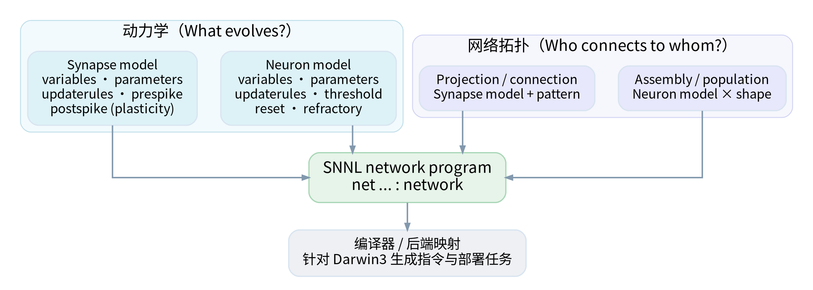
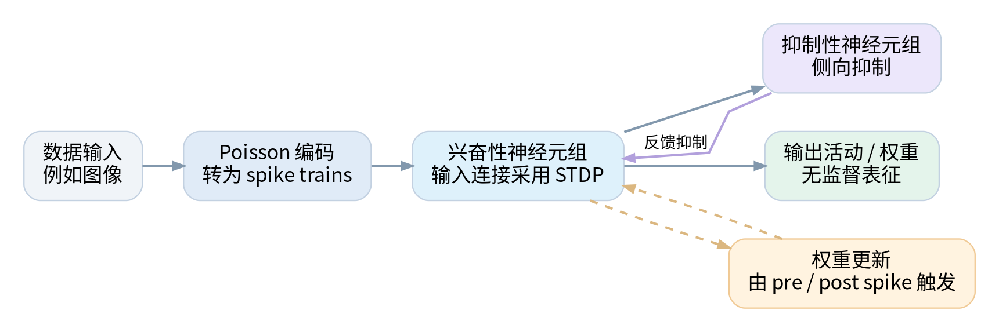
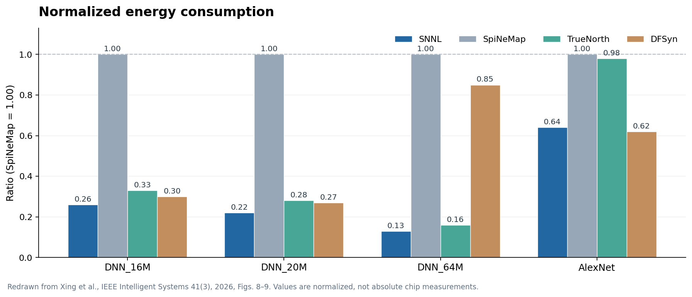
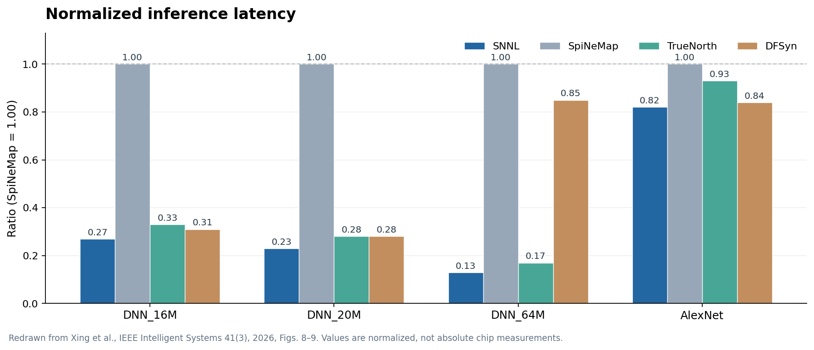

# SNNL: A Programming Language for Spiking Neural Network Development

> **论文**：Qinghui Xing, Zirun Li, Ying Li, Schahram Dustdar, Xin Du, Gang Pan, Shuiguang Deng. *SNNL: A Programming Language for Spiking Neural Network Development*. **IEEE Intelligent Systems**, 41(3): 23–34, 2026.  
> **DOI**：[10.1109/MIS.2025.3636128](https://doi.org/10.1109/MIS.2025.3636128)  
> **发表时间**：2025-11-25 在线发表；期刊刊期发表时为 2026 年 5–6 月。  
> **关键词**：SNN、DSL、神经动力学、拓扑抽象、编译器、Darwin3、STDP、Mapping。  
> **阅读定位**：这是一篇**编程语言与软硬件协同**论文，不是提出新神经元模型、新训练算法或新芯片的论文。本文所有图均为基于论文内容重新绘制的教学图；原论文对应图号和页码注明在正文中。

## 1. 论文要解决什么问题？

SNN（Spiking Neural Network，脉冲神经网络）的程序并非只有一个普通神经网络计算图，而是同时包含两种信息：

- **动力学（Dynamics）**：每个神经元、突触在时间推进或收到 spike 时如何更新内部状态；
- **拓扑（Topology）**：哪些神经元连接，连接的方式与权重如何组织，以及这些神经元如何部署到硬件上。

已有生态中，Brian2 擅长用方程描述模型，PyNN 擅长抽象不同仿真器；但“**把复杂 SNN 的模型与连接关系完整表达出来，再高效编译到指定神经形态芯片**”仍存在工程障碍。

**作者的解决方案**是 SNNL（Spiking Neural Network Language）：用领域专用语言分别描述动力学与拓扑，再通过编译器转换为 Darwin3 等神经形态系统能够执行的指令和映射结果。



*图 1（重绘）：动力学回答“神经元如何变化”，拓扑回答“神经元如何连接”；二者在编译阶段合流。对应Figures 2–4。*

**总结**：Darwin3 解决了“芯片能执行什么”，SNNL 进一步研究“研究者如何描述一个 SNN，并把它交给芯片执行”。

---

## 2. 最重要的 5 项研究贡献

### 2.1 将神经动力学与网络拓扑分离为两套可组合的程序抽象

**核心观点 / 成果**  
SNNL 将时间相关的神经元、突触行为与空间相关的网络连接分开描述，再在网络程序中组合，降低 SNN 建模和硬件部署之间的耦合程度。

**解决的痛点**  
在不同芯片、连接布局与模型实验之间切换时，神经元更新方程、连接关系及硬件相关细节容易混杂：更换一个神经元模型，可能不得不改网络构造；更换连接结构，也可能影响计算实现。这样的代码难以复用、难以迁移。

**创新点**  
作者把语言划分为两个相互独立的模块：

| 抽象层 | 主要对象 | 描述内容 | 对应原论文 |
| --- | --- | --- | --- |
| Neural dynamics | `neuron`、`synapse` | 状态变量、参数、演化方程、spike 事件 | Figure 3 |
| Network topology | assembly、projection、`net` | 神经元组形状、连接模式、网络层次 | Figure 4 |

这不是简单将代码拆成两个文件，而是**在语言层面定义两个独立的语义对象**，让同一个动力学模型能够被不同的网络结构复用。

**关键结果**  
论文用 LIF 神经元、STDP 突触及类似 LeNet-5 的多层网络分别展示了两套描述方式，并在 Figure 7 中将它们组合为一套可下发硬件的应用。这里的证据主要是**功能可行性和表达能力的案例展示**，不是对开发时间、代码长度或学习成本的定量证明。

**学术意义**  
将 SNN 的语义与硬件资源分配区分开，为之后的 compiler optimization、模型复用以及多后端支持提供更清楚的中间层。它最接近传统软件工程中的“**前端建模语言与后端目标架构解耦**”。

### 2.2 用“方程演化 + 事件响应”统一表达神经元及突触可塑性

**核心观点 / 成果**  
SNNL 用连续时间动力学、离散步进求解和 spike 事件触发规则构建统一的模型描述方式，从而覆盖神经元更新、发放与突触学习三类行为。

**解决的痛点**  
SNN 与普通 ANN 不同：不仅要计算激活，还要追踪随时间变化的膜电位、突触电导或 spike traces；收到 pre-/post-synaptic spike 后，权重还可能突然更新。仅有静态的“层 + 激活函数”不足以表达这些行为。

**创新点**  
SNNL 对两种计算分别给出显式语法：

| 语法模块 | 作用 | 关键点 |
| --- | --- | --- |
| `variables` / `parameters` | 声明状态与参数 | 各神经元实例状态独立；模型参数可共享 |
| `updaterules` | 描述随时间演化的状态方程 | 支持微分方程及数值求解 |
| `solver` | 指定数值求解方法 | 论文示例使用 `euler` |
| `threshold`、`reset`、`refractory` | 定义 spike 触发、重置和不应期 | 描述神经元离散事件行为 |
| `prespike`、`postspike` | 对应前、后突触 spike 事件处理 | 可表达 STDP 等可塑性规则 |

例如，简单 LIF 模型可以抽象为：

$$
\tau_m\frac{dV}{dt}=-(V-V_{\mathrm{rest}})+RI(t)
$$

当 $V\geq V_{\mathrm{th}}$ 时发放 spike，并将膜电位重置。使用 Euler 法离散化，可得到：

$$
V_{t+1}=V_t+\frac{\Delta t}{\tau_m}\left[-(V_t-V_{\mathrm{rest}})+RI_t\right].
$$

这些公式是**为解释机制而整理的 LIF 通式**，不是论文 Figure 3 中那段带适应性参数的完整代码。SNNL 的意义在于可以分别表达“日常时间更新”和“事件到来时的突变”。

**关键结果**  
论文 Figure 3 给出 LIF 与 STDP 两个实例，Figure 7 展示了它们在同一个无监督 SNN 任务中的组合。原文**未提供系统性的数值误差曲线、长时间积分稳定性测试或多个求解器的精度比较**，因此“能够描述”不应直接等同于“各种动态都被高精度地验证”。

**学术意义**  
把数学模型转化为可编译的形式化程序，使编译器有机会针对事件驱动更新、冗余计算消除、寄存器分配和神经形态指令选择进行优化。

### 2.3 用神经元组与连接投影表达复杂网络，而不必逐条列出突触

**核心观点 / 成果**  
SNNL 将网络构造提升到 assembly 和 projection 层次，让网络的结构设计不必依赖逐神经元、逐突触的手工描述。

**解决的痛点**  
一个卷积型 SNN 可能包含大量规则连接。如果在源码中为每条边逐一指定源神经元、目标神经元及权重，不仅冗长，也难以让编译器识别卷积、全连接和共享权重等结构特征。

**创新点**  
原论文 Figure 4 给出三种核心结构语法：

```text
inputs = lif * (28, 28)
dense  = lif * 120
fully_connected = connections(delta, FULL)

net example: network
    inputs -- fully_connected(weights_init=0.25) -> dense
```

*上面是依据 Figure 4 简化的语法示意，不是完整可执行的 SNNL 工程。*

- `model * shape`：将神经元模型实例化为具有指定维度的神经元组；
- `connections(synapse, pattern)`：组合突触行为与连接模式；
- `net ... : network`：在网络级连接各个 assembly 与 projection。

论文还展示了卷积、全连接、一对一、全对一等连接概念，Figure 4 将它们组合为 LeNet-5 风格的网络。

**关键结果**  
论文证明性地展示了该语言**可以表达**多个不同大小和不同连接类型的神经元组；但没有单独报告拓扑编码长度、内存占用、前端解析时间或网络结构覆盖率等定量结果。语言本身也不直接等于 Darwin3 芯片中的物理连接压缩机制。

**学术意义**  
拓扑由结构化对象表示，使后续 Graph Partitioning、Task-to-Core Mapping、通信优化以及特定连接模式的硬件降级（lowering）成为可独立研究的编译问题。

### 2.4 建立从 SNNL 源程序到 Darwin3 指令与资源映射的编译链

**核心观点 / 成果**  
论文展示了一个面向 Darwin3 的编译器，使高层 SNN 模型与网络描述能够经过方程处理、代码生成和硬件资源映射，形成可部署任务。

**解决的痛点**  
“模型能够在 Python 中表示”与“模型能够在神经形态芯片上运行”之间仍隔着多层问题：状态更新如何转换为指令、网络如何切分到 core、跨 core spike 如何传输、每个 core 执行什么程序。

**创新点**  
编译器采用分层设计。论文 Figure 6 主要包含：

1. **Frontend**：解析源程序并构建中间表示；
2. **Program segmentation / equation solving**：区分动力学、拓扑、一般程序，并处理方程；
3. **Program synthesis / LLVM**：综合顺序计算过程，借助 LLVM IR 和后端生成支持的代码；
4. **Neural dynamics lowering**：将神经元/突触更新转为目标神经计算指令；
5. **Network / task-resource mapping**：把逻辑网络实体映射到实际计算核，形成部署任务。


*图 2（重绘）：自高层模型进入神经形态硬件的关键阶段。对应原论文 Figure 6（PDF 第 8 页）与 Figure 7（PDF 第 9 页）。此图仅表示论文描述的主要流程，并不意味着每一步已开放为独立工具。*

**关键结果**  
Figure 7(c) 给出了由神经元描述生成的目标神经指令示例，Figure 7(d) 展示编译产物的多核部署。论文还在 Figure 8–9 中给出了能耗及推理延迟比较，体现了整个工具链可执行、可评估。

**学术意义**  
这项贡献打通了**高层 DSL → 模型计算 → 硬件 ISA → 多核部署**的链路，是论文最贴近 AI Systems / Compiler 研究的部分。不过，论文没有公开足以独立复核每个优化 pass 的完整算法、代价模型和消融实验；“编译器效率来源于何处”仍需更多证据。

### 2.5 通过 STDP 部署案例和系统指标验证编程框架的可行性

**核心观点 / 成果**  
论文不只提出语言语法，还展示了含 STDP 的 SNN 开发到部署流程，并报告所评估 workload 下能耗和推理延迟相较对照方法降低。

**解决的痛点**  
只有语法设计而没有端到端执行与量化结果，无法确认新的编程抽象能否融入真实神经形态系统，也无法判断高层抽象是否会带来过大的运行开销。

**创新点**  
将三层 SNN、Poisson spike 编码、STDP 学习规则、网络编译、任务映射与后端运行串联为端到端示例，并用归一化能耗与推理延迟评估系统级结果。

**关键结果**  
Figure 7 展示输入层—兴奋层—抑制层及其突触学习和部署过程；Figure 8–9 报告了 **DNN_16M、DNN_20M、DNN_64M、AlexNet** 四组测试。与 SpiNeMap（标准化为 1.00）相比，SNNL 的结果为：

| Workload | Energy ratio ↓ | Latency ratio ↓ | 相对 SpiNeMap 的能耗降低 | 相对 SpiNeMap 的延迟降低 |
| --- | ---: | ---: | ---: | ---: |
| DNN_16M | 0.26 | 0.27 | 74% | 73% |
| DNN_20M | 0.22 | 0.23 | 78% | 77% |
| DNN_64M | 0.13 | 0.13 | 87% | 87% |
| AlexNet | 0.64 | 0.82 | 36% | 18% |

*表中比例是根据论文 Figure 8–9 的柱顶数值整理，百分比为 $1-\mathrm{ratio}$ 的计算结果，不是作者另外报告的独立统计指标。*

**学术意义**  
语言设计不必止于前端可用性：若高层语义能够帮助编译器识别状态更新、并行任务与通信结构，就有机会实现**可编程性与硬件效率的协同**。但这些图不能直接证明哪一个单独的编译优化产生了收益，也不能把归一化数值理解为芯片实测焦耳或毫秒。

---

## 3. 重点技术：SNNL 如何把模型真正部署到芯片？

### 3.1 网络与训练示例

原论文 Figure 7 的实验采用：

- 输入层：将原始输入经 **Poisson encoding** 转换为 spike train；
- 兴奋层（Excitatory）：与输入层全连接，该部分突触采用 **STDP** 规则；
- 抑制层（Inhibitory）：与兴奋层神经元数目相同；
- 抑制连接：每个兴奋神经元对应一个抑制神经元，而抑制神经元向其他兴奋神经元形成侧向抑制；
- 编译与部署：将神经元、突触模型转换为可执行指令，把计算任务分配到多个 core。



*图 3（重绘）：对 Figure 7(a) 的计算逻辑进行简化。这里的权重更新箭头表示 STDP 的语义，并不单独证明在实际芯片上已测量到在线训练收敛。*

STDP 的核心思想是根据前后 spike 的相对时序改变权重，典型形式为：

$$
\Delta w=\begin{cases}
A_+\exp(-\Delta t/\tau_+), & \Delta t>0,\\
-A_-\exp(\Delta t/\tau_-), & \Delta t<0,
\end{cases}
$$

其中 $\Delta t=t_{\mathrm{post}}-t_{\mathrm{pre}}$。这是一种**用于帮助理解的经典 pair-based STDP 表达式**；论文示例的 SNNL 程序使用 `pre_trace`、`post_trace` 在 `prespike` / `postspike` 中更新，不能未经验证就认为两者参数与离散时间行为完全相同。

### 3.2 训练与部署应区分哪些环节？

| 环节 | 问题 | 论文中的证据 |
| --- | --- | --- |
| Model definition | 是否能够表达 LIF / STDP？ | Figure 3、Figure 7(b) |
| Training rule specification | 是否能够声明权重如何随 spike 改变？ | `prespike` / `postspike` 示例 |
| Compilation | 是否能够生成芯片支持的指令？ | Figure 7(c) |
| Core mapping | 是否能够分配到神经形态 core？ | Figure 7(d) |
| Runtime performance | 能耗与延迟怎样？ | Figures 8–9（归一化指标） |
| Learning quality | 学习后准确率、稳定性、收敛与硬件数值一致性怎样？ | **论文未给出充分的专门定量验证** |

**特别注意**：图中展示 STDP 学习规则与部署流水线，不等于完成了“片上持续在线训练优于其他方法”的实验。要证明这一点，还需要确认权重更新实际发生的端侧位置、硬件数值精度、学习曲线、与软件参考实现的一致性等。

---

## 4. 实验图表：能从数据中得出什么？



*图 4（重绘）：论文 Figure 8 的归一化能耗，SpiNeMap = 1。*



*图 5（重绘）：论文 Figure 9 的归一化推理延迟，SpiNeMap = 1。*

图中比较对象包括 **SNNL、SpiNeMap、TrueNorth、DFSyn**。几个观察值得区分：

1. 在前三组 DNN workload 中，SNNL 相对 SpiNeMap 的能耗和延迟均明显更低；**AlexNet 的优势则小得多**，说明效果与 workload 有关；
2. Figures 8–9 给的是 **normalized ratios**，并非芯片功耗、单次推理能量或绝对毫秒值；
3. SpiNeMap 与 DFSyn 主要是 SNN mapping / synthesis 相关方法，而 TrueNorth 通常指具体硬件体系。它们的抽象层次并不完全相同，因而不能仅凭这两张图断言“编程语言本身优于某一芯片”；
4. 论文没有在该篇中充分交代各 baseline 在相同芯片、工作负载与功耗测量方法下如何严格对齐，也未给出误差棒、独立重复实验统计或 compiler-pass 消融。因此，适当的结论是：**作者报告的系统级结果支持这套框架的可行性和效率潜力，但具体收益来源仍有待进一步剥离验证。**

---

## 5. 如何看待论文的“图灵完备性”论证？

原文 **Turing Completeness** 一节（大致在Figure 5）不是可忽略的背景材料，但需要以不同于实验结果的证据标准来阅读。

### 5.1 作者的思路

论文试图把图灵机的三项机制映射至 SNN：

| 图灵机部件 | 论文中的 SNN 表示 | 代表性公式 / 描述 |
| --- | --- | --- |
| 有限控制状态 $Q$ | 神经元膜电位状态经聚类离散化 | $\hat q=\arg\min_{q\in Q'}\|v-q\|$ |
| 纸带上的符号 | spike 输入、突触权重与解码函数 | $y_t=Wx_t$ |
| 状态转移与读写头移动 | 神经动力学、权重更新及位置变量 | $v_{t+1}=f(v_t,x_t)$，$p'=p+d$ |

作者据此描述一个循环过程：状态初始化 → 状态更新 → 写入符号 → 读写头移动 → 重复，直至停机。

### 5.2 需要保持的判断

**这更接近图灵机模拟的构造性论证框架，而不是充分严格的 SNNL 语言图灵完备性定理。** 原因有三点：

1. **有限状态近似不等于精确模拟**：聚类误差能够变小，不自动保证任意步计算都与离散图灵机保持完全一致，尤其是在分支决策边界附近；
2. **无限纸带资源没有被严格解决**：传统图灵机要求在需要时可使用任意多纸带单元，而实际有限神经元数、有限存储位宽的硬件不能直接提供无限纸带；
3. **从抽象 SNN 到具体 SNNL 语义存在缺口**：证明 SNN 某些动力学可以编码状态，并不自动证明 SNNL 的受支持语法、编译器、固定资源后端能够表达并执行任意计算。

因此，**作者其实并不是在严格证明实际 Darwin3 上的 SNNL 程序具有无限计算能力”**。若后续做相关理论研究，可以重点检查精确状态编码、资源无界假设、权重更新规则的可实现性以及停机语义。

---

## 6. 与 Darwin3、Darwin-S、Brian2、PyNN 的关系

| 系统 / 工具 | 所处层次 | 解决的主要问题 | 与 SNNL 的关系 |
| --- | --- | --- | --- |
| **Darwin3**（2024） | 芯片 / ISA / 多核互连 | 神经计算如何在可编程硬件上执行 | SNNL 的目标硬件之一；论文展示 Darwin3 定向后端 |
| **Darwin-S**（2022） | 参考软件架构 / 运行环境 | 如何管理神经形态硬件资源和应用 | 为上层应用开发及运行时提供系统背景；不是 SNNL 的别名 |
| **Wuyuan（五元）工具链** | Darwin3 相关开发与部署工具链 | ANN-to-SNN、量化、编译、部署等 | 出现在 Darwin3 芯片论文中；**本篇没有证明它与 SNNL 的代码仓库或产品实现完全相同** |
| **Brian2** | 方程式 SNN 建模与仿真 | 灵活定义神经元、突触动力学 | SNNL 借鉴其方程描述方式，更强调专用硬件编译 |
| **PyNN** | 跨仿真器 API | 一次建模、多后端仿真及部分硬件支持 | 和 SNNL 都寻求抽象，但现有后端范围与表达方式不同 |
| **Loihi / Loihi 2 生态** | 神经形态芯片及其软件工具 | 提供另一类软硬件协同平台 | 可作相关研究对照；**本篇没有验证 SNNL 可直接编译到 Loihi 2** |

**最重要的层次关系**：

```text
SNNL                语言层：表达神经元、突触及连接
   ↓
SNNL Compiler       编译层：方程处理、指令生成、任务映射
   ↓
Darwin3 ISA         指令接口：硬件能够执行的操作
   ↓
Darwin3 Cores / NoC 运行层：计算、存储、跨核 spike 通信
```

与前一篇 **Darwin3** 的互补关系尤其明确：

- Darwin3 的研究重点：专用 ISA、连接压缩、多核拓扑与片上学习硬件能力；
- SNNL 的研究重点：模型/拓扑如何**在高层被表达，再经编译落到这些能力上**；
- 两者形成一条从 **Algorithm → Language → Compiler → ISA → Hardware** 的研究主线。

需要注意：**“SNNL 可用于不同神经形态架构”属于设计目标与潜力**，目前这篇论文直接呈现的是 Darwin3 定向编译与部署流程，而非对 Loihi、SpiNNaker 等多后端的逐一验证。

---

## 7. 局限与值得继续做的研究问题

| 方向 | 当前论文已经解决/展示的内容 | 仍可进一步验证的问题 |
| --- | --- | --- |
| 语义正确性 | 展示 LIF、STDP 建模和方程求解流程 | 与 Brian2 参考模拟的逐时间步误差、事件顺序和边界条件 |
| 编译优化 | 展示分层编译、指令生成和 task-to-core 分配 | 不同 pass 的独立收益：算术化简、融合、寄存器、通信代价 |
| Mapping | 展示逻辑任务至多核的分配 | 加入通信 trace、NoC 路由与拥塞后优化是否仍有效 |
| 学习支持 | 展示 STDP 描述和部署案例 | 真正的片上在线更新、精度、收敛、可塑性代价 |
| 语言表达能力 | 展示卷积/全连接等结构 | 循环网络、动态拓扑、条件控制与超大规模稀疏连接 |
| 跨架构可移植性 | 设计上采用前后端分层 | 非 Darwin3 backend 是否可实现、维护代价如何 |
| 工程可复现性 | 提供示例代码截图和系统性能图 | 可访问编译器、完整环境、workload、脚本、功耗计量方法 |

### 一个后续也许值得做的实验：Compiler/Mapping Ablation

如果继续做 AI Systems / Neuromorphic Compiler，可以设计四个版本：

1. **Baseline**：直接按源码语义生成指令，使用简单顺序的任务映射；
2. **+ Dynamics optimization**：只优化神经元与突触更新指令；
3. **+ Mapping optimization**：加入基于 spike traffic 的 task-to-core 分配；
4. **+ Joint optimization**：联合考虑每核计算负载、跨核 spike 与资源约束。

统一比较 `instruction_count`、`memory_bytes`、`inter-core_spikes`、`hop_count`、`energy`、`latency`、`spike timing error`、`accuracy`。这样才能进一步回答：**效率改进到底来自 ISA、编译器、Mapping，还是具体的网络结构？**

这是从论文中推导出的**后续研究建议**，不是作者已经完成的消融实验。若无法访问 SNNL 的实际实现，可先用自定义 SNN IR + 可复现 simulator 验证核心优化思想。

---

## 8. 结论

SNNL 的真正价值不在于创造了又一种写 SNN 的语法，而在于尝试建立一条清晰的**从 SNN 数学模型到硬件可执行程序的编译路径**：

1. 动力学与网络拓扑分离，使模型和连接关系可组合复用；
2. 用方程加 spike 事件规则表达推理与突触可塑性；
3. 用神经元组、projection 等结构避免低层逐连接编程；
4. 通过分层 compiler 对接 Darwin3 指令及多核资源；
5. 用 STDP 案例和归一化能耗、延迟结果，证明这条路径具备端到端可行性和效率潜力。

**读完本篇保留的问题**：当神经形态硬件越来越复杂时，能否设计一种既有较强神经模型表达能力、又能暴露足够优化信息的 SNN 中间表示，并且在不同芯片上保留相同语义？这比单纯增加语言关键字更接近长期有价值的研究方向。

---

## 参考资料

1. Xing et al. *SNNL: A Programming Language for Spiking Neural Network Development*. IEEE Intelligent Systems, 2026. [DOI](https://doi.org/10.1109/MIS.2025.3636128)。主要阅读材料，PDF 共 12 页。  
2. Ma et al. *Darwin3: a large-scale neuromorphic chip with a novel ISA and on-chip learning*. National Science Review, 2024. [DOI](https://doi.org/10.1093/nsr/nwae102)。用于理解目标芯片的 ISA / NoC 能力。  
3. Deng et al. *Darwin-S: A Reference Software Architecture for Brain-Inspired Computers*. Computer, 2022. [DOI](https://doi.org/10.1109/MC.2022.3144397)。用于补充软件体系结构背景。  
4. [PyNN 官方说明](https://pynn.readthedocs.io/en/latest/introduction.html)。用于核对 PyNN 的跨仿真器与硬件接口能力。  
5. [原论文页面（IEEE Xplore）](https://ieeexplore.ieee.org/abstract/document/11268529)。

> **版权说明**：本文五张配图为依据论文结构与图中实验数据重新绘制的学习图表，不是原论文图像的直接截图。原论文版权归相应权利人所有；对论文的转述、数值和观点均标注了原始图号/页码，正式发表或引用时请参照原论文。
