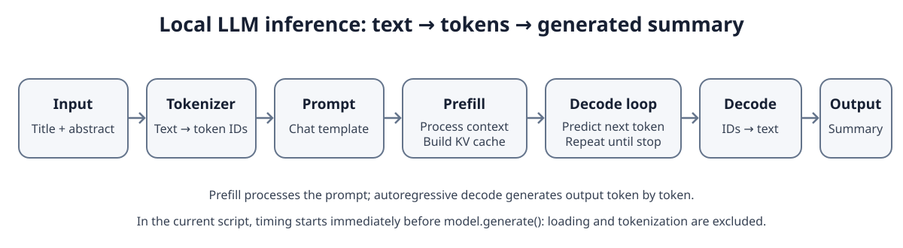
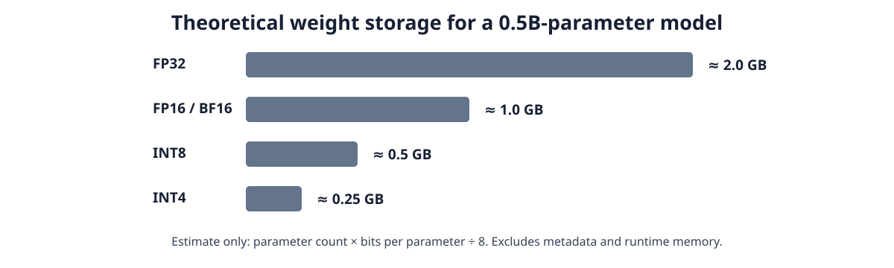
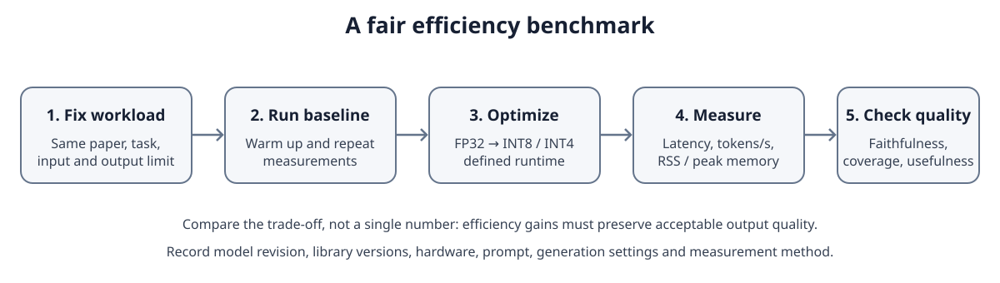

# Efficient AI Lecture 01：从本地 LLM 推理到性能评估

> **系列：** Efficient AI 基础　｜　**实践项目：** ResearchPulse  
> **实验环境：** Windows + WSL Debian、CPU、PyTorch、Transformers  
> **模型：** `Qwen/Qwen2.5-0.5B-Instruct`，FP32
> **时间：**  2026.10

## 1. Efficient AI 关注什么？

Efficient AI 研究如何在满足质量要求的前提下，降低模型的计算、存储、延迟、能耗或服务成本。优化可能发生在模型表示、算子、推理运行时和系统调度等不同层面。

ResearchPulse 的任务是自动总结论文。当前已跑通云端 API 摘要，并完成了本地模型的第一轮推理。接下来需要比较不同方案在**质量、延迟、内存和成本**上的权衡。

## 2. LLM 推理流程

- **Tokenization**：把文本切分为 Token，并转换成 token IDs。
- **Prompt formatting**：将角色、指令和文本组织成模型预期的格式。`apply_chat_template()` 使用 tokenizer 对应的 Chat Template；模板应匹配模型训练时的消息格式。
- **Prefill**：处理输入序列，计算上下文表示，并建立供后续生成复用的 KV Cache。
- **Decode**：自回归地逐 Token 生成，直到遇到停止条件或达到 `max_new_tokens`。
- **Detokenization**：将生成的 Token IDs 转回可读文本。

`AutoTokenizer` 负责编码和解码；`AutoModelForCausalLM` 加载因果语言模型；`model.generate()` 执行文本生成。模型加载、分词和生成是不同阶段，性能测量时应分别计时。

## 3. 参数量、数值精度与内存

模型参数是神经网络在训练过程中学到的数值。`0.5B` 表示约五亿个参数，不代表模型文件大小为 0.5 GB。

权重理论存储量可近似估算为：

\[
\text{Weight Size} \approx N_{\text{params}} \times \frac{b}{8}
\]

其中 \(N_{\text{params}}\) 是参数数量，\(b\) 是每个参数的位数。

| 表示方式 | 每参数位数 | 0.5B 参数的理论权重大小 |
|---|---:|---:|
| FP32 | 32 bit | 约 2.0 GB |
| FP16 / BF16 | 16 bit | 约 1.0 GB |
| INT8 | 8 bit | 约 0.5 GB |
| INT4 | 4 bit | 约 0.25 GB |

以上是十进制 GB 下的权重估算，不包括量化元数据、未量化层、激活、KV Cache 和运行时开销。

- **FP32**：32 位浮点表示；当前实验以此作为本地基准。
- **FP16 / BF16**：16 位浮点表示，位宽相同，但指数与有效数位的分配不同。
- **INT8 / INT4**：低位宽整数表示。量化通常需要 scale 等参数，将原始权重映射到较低精度的数值空间。

**量化（Quantization）**通过降低权重和/或激活的表示精度，减少存储与计算开销。收益取决于模型、算法、硬件和运行时；更低位宽不保证推理一定更快，也可能带来质量损失。PTQ（Post-Training Quantization）在训练后量化；QAT（Quantization-Aware Training）在训练中模拟量化影响。

## 4. 推理效率的核心指标

| 指标 | 含义 | 测量注意点 |
|---|---|---|
| Latency | 一次请求完成所需时间 | 区分加载、分词、首 Token 和完整生成 |
| Throughput | 单位时间完成的请求或 Token 数 | 区分单请求速度与并发服务吞吐量 |
| Tokens/s | 生成 Token 数 ÷ 生成耗时 | 必须记录输出 Token 数和计时范围 |
| Model size | 权重或模型文件大小 | 理论权重、磁盘文件和运行内存不同 |
| Memory | 进程或模型运行时的内存占用 | RSS 采样值不等于峰值内存 |
| Quality | 输出的忠实性、覆盖度、简洁性与实用性 | 固定任务与评分标准；LLM Judge 不是绝对真值 |
| Cost / Energy | API 费用或本地运行成本、能耗 | 说明计费口径、硬件和运行时间 |

**Latency** 衡量单次请求的时间成本；**throughput** 衡量系统单位时间完成的工作量。生成任务还可区分 TTFT（Time to First Token）和完整输出耗时。Prefill 主要处理输入上下文；Decode 逐 Token 生成，长输出通常会增加总耗时。

## 5. ResearchPulse：第一轮 FP32 实验

| 项目 | 实测记录 |
|---|---|
| 模型 | `Qwen/Qwen2.5-0.5B-Instruct` |
| 环境 | Windows + WSL Debian，CPU 推理 |
| 精度 | FP32 |
| 单次生成延迟 | 15.913 s |
| 生成后进程 RSS | 2611.8 MiB（程序标签显示为 MB） |
| 参数存储估算 | 1884.6 MiB（程序标签显示为 MB） |

当前脚本在调用 `model.generate()` 前开始计时，因此 **15.913 s 是生成阶段耗时**，不包括模型下载、加载和输入分词。内存是在生成后采样的进程 RSS，不代表运行期间峰值；参数大小通过参数数量乘以元素字节数计算，不包含所有运行时开销。

代码使用 `1024 × 1024` 换算字节，因此数值单位更准确地说是 **MiB**，而非十进制 MB。后续实验应统一单位和测量口径。

## 6. 如何建立公平的 Benchmark？

量化前后比较时，至少固定以下条件：

1. 使用同一批论文、输入文本和任务要求。
2. 固定 Prompt 的语义、输出长度限制和生成参数。
3. 记录模型版本、库版本、硬件、线程设置与量化运行时。
4. 模型加载后先预热，再重复测量多次，报告中位数及波动范围。
5. 同时记录延迟、生成 Token 数、Tokens/s、内存和摘要质量。

质量评估可沿用 ResearchPulse 已有的四个维度：**Faithfulness（忠实性）、Coverage（覆盖度）、Conciseness（简洁性）、Usefulness（实用性）**。小规模人工评估可作为校验；LLM Judge 可以扩展评估，但结果仍可能存在偏差。

量化的目标是在质量约束下获得效率收益。若 INT8 / INT4 节省内存，却让摘要质量降到不可接受，就不能视为有效优化。

## 参考资料

1. Qwen Team, [Qwen2.5-0.5B-Instruct 模型卡](https://huggingface.co/Qwen/Qwen2.5-0.5B-Instruct)
2. Hugging Face, [Chat Templates](https://huggingface.co/docs/transformers/main/chat_templating)
3. Hugging Face, [Transformers Quantization](https://huggingface.co/docs/transformers/main_classes/quantization)
4. Hugging Face, [Bitsandbytes Quantization](https://github.com/huggingface/transformers/blob/main/docs/source/en/quantization/bitsandbytes.md)
5. PyTorch, [Profiler Recipe](https://docs.pytorch.org/tutorials/recipes/recipes/profiler_recipe.html)
