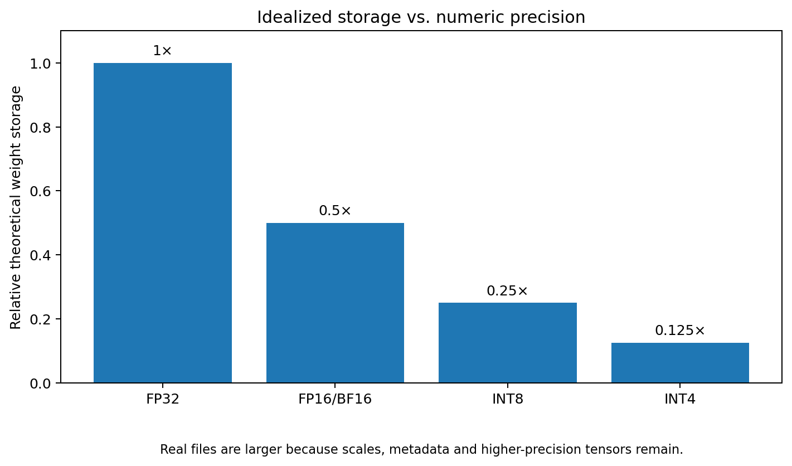
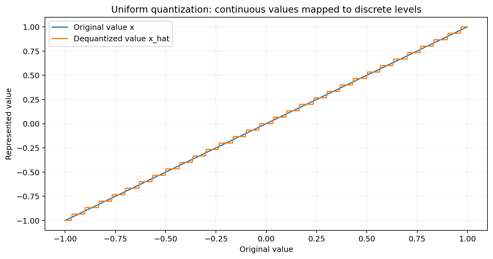
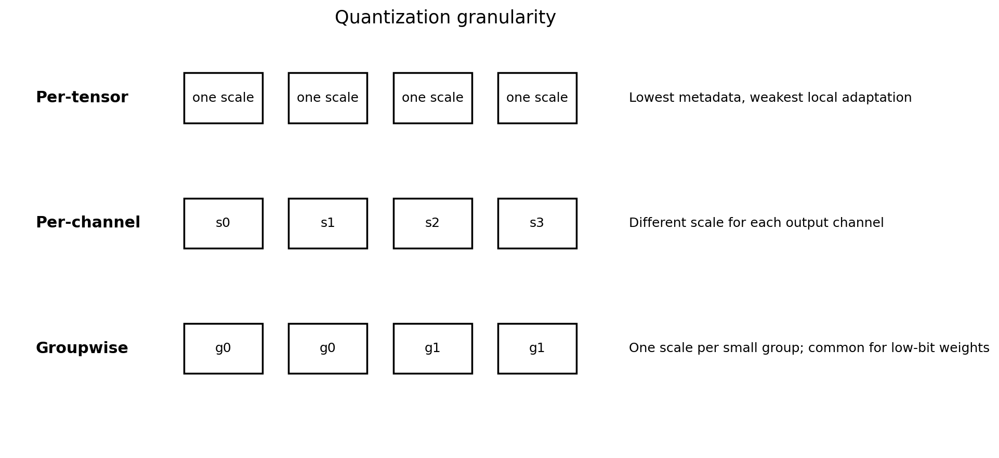
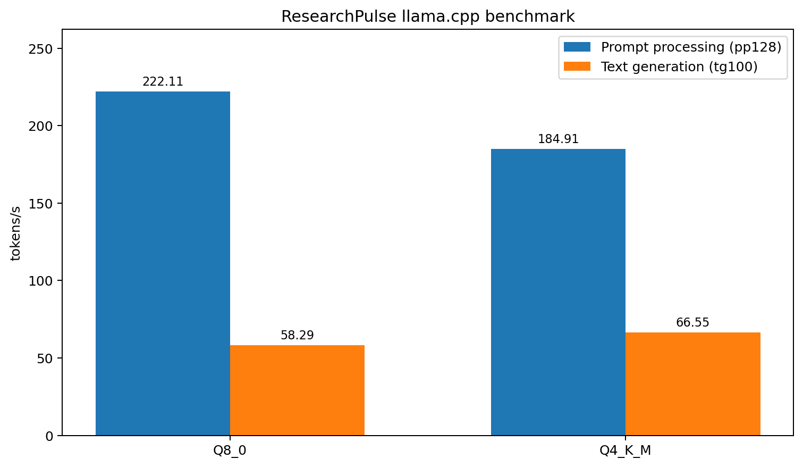
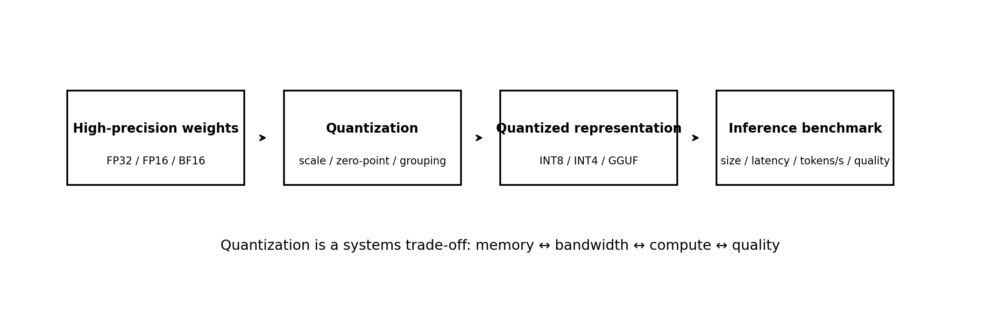

# Efficient AI 03：模型量化原理与 INT8 / INT4 实践

> **系列：** Efficient AI 基础　
> **实验环境：** Windows + WSL Debian、CPU、PyTorch、Transformers  
> **关键词**：Quantization · INT8 · INT4 · PTQ · QAT · Scale · Zero-point · Groupwise · GGUF · Q8_0 · Q4_K_M  
> **时间：**  2026.11
---

## 0. 先建立直觉：量化到底在做什么？

神经网络里最占空间的东西之一，是大量参数。

假设一个模型有 $N$ 个参数，如果每个参数使用 $b$ bit 存储，那么仅看权重：

$$
\text{Memory} \approx N \times \frac{b}{8}
$$

所以理论上：

| 精度 | 每个参数 | 相对 FP32 的理论存储 |
|---|---:|---:|
| FP32 | 32 bit | 1× |
| FP16 / BF16 | 16 bit | 0.5× |
| INT8 | 8 bit | 0.25× |
| INT4 | 4 bit | 0.125× |



因此量化最直观的目标就是：

> **用更少的 bit 表示模型权重，同时尽量保持原模型行为。**

但量化不是简单地把：

```text
float → int
```

而是要解决一个核心问题：

> 原来的浮点数范围很大，而 INT8 / INT4 只能表示有限个离散值，怎么把两者对应起来？

---

## 1. 最核心的数学：Scale 与 Zero-point

一个常见的均匀量化写法是：

$$
q=
\operatorname{round}\left(\frac{x}{s}\right)+z
$$

其中：

- $x$：原始浮点数；
- $q$：量化后的整数；
- $s$：scale，控制“一个整数单位代表多大的浮点范围”；
- $z$：zero-point，让浮点数 0 映射到某个整数。

真正计算时，需要近似恢复：

$$
\hat{x}=s(q-z)
$$

于是：

```text
原始浮点数 x
    ↓
Scale / Zero-point
    ↓
离散整数 q
    ↓
反量化得到 x̂
```



### 一个简单例子

假设某组权重范围大约是：

$$
[-1,1]
$$

如果使用 8 bit signed integer，大致有：

$$
[-127,127]
$$

可以取：

$$
s\approx\frac{1}{127}
$$

例如：

$$
x=0.50
$$

则：

$$
q\approx \operatorname{round}(0.50\times127)=64
$$

反量化：

$$
\hat{x}\approx\frac{64}{127}\approx0.504
$$

它不再和原始值完全一样，但很接近。

---

## 2. 量化误差从哪里来？

由于连续浮点数被压缩到有限的整数等级中：

$$
e=x-\hat{x}
$$

这就是 Quantization Error。

### INT8

INT8 有大约：

$$
2^8=256
$$

个离散等级。

### INT4

INT4 只有：

$$
2^4=16
$$

个等级。

因此通常来说：

```text
INT4
离散等级更少
→ 表示更粗糙
→ 更容易产生量化误差
```

但这不意味着：

```text
INT4 一定不能用
```

因为模型最终是否掉质量，还取决于：

- Scale 怎么计算；
- 哪些权重共用一个 Scale；
- 是否有异常值；
- 哪些层被保留成高精度；
- Runtime 是否有合适的量化 Kernel；
- 模型本身是否对误差敏感。

所以真正的问题不是：

> “4 bit 会不会掉精度？”

而是：

> **“如何设计 4 bit 表示，让关键权重尽量不丢信息？”**

---

## 3. 对称量化与非对称量化

### 3.1 Symmetric Quantization

如果权重大致围绕 0 分布，可以直接让：

$$
z=0
$$

此时：

$$
q=\operatorname{round}\left(\frac{x}{s}\right)
$$

$$
\hat{x}=sq
$$

优点：

- 简单；
- 计算方便；
- 很适合权重量化。

---

### 3.2 Asymmetric Quantization

如果数据明显偏向一侧，可以使用非零的 zero-point：

$$
\hat{x}=s(q-z)
$$

这样可以更充分利用整数空间。

例如数据范围：

$$
[0,6]
$$

如果仍然以 0 为中心，会浪费一半整数范围。

所以：

```text
Symmetric
适合接近 0 对称的分布

Asymmetric
适合明显偏移的分布
```

---

## 4. 比 bit width 更重要的问题：多少个数共用一个 Scale？

这叫：

> **Quantization Granularity**



---

### 4.1 Per-Tensor

整个 Tensor 只有一个 Scale：

$$
W \rightarrow (Q,s)
$$

优点：

```text
简单
元数据少
```

缺点：

```text
一个异常值就可能影响整个 Tensor
```

---

### 4.2 Per-Channel

每个输出 Channel 都有自己的 Scale：

$$
W_i \rightarrow (Q_i,s_i)
$$

这样每个 Channel 都可以根据自己的数值范围量化。

通常：

```text
精度更好
但需要更多 Scale
```

---

### 4.3 Groupwise / Blockwise

把权重分成小组：

```text
[w0 ... w31] [w32 ... w63] ...
     ↓             ↓
   scale0        scale1
```

每个小组单独计算 Scale。

这是现代低比特 LLM 量化里非常常见的思路。

本质是在平衡：

$$
\text{更细的 Scale}
\quad\leftrightarrow\quad
\text{更多元数据}
$$

Group 越小，通常越能贴合局部权重分布，但额外开销也更大。

---

## 5. 为什么 Outlier 很麻烦？

假设一组权重中绝大多数都在：

$$
[-0.1,0.1]
$$

但突然出现一个：

$$
4.0
$$

如果整组共用一个 Scale，那么为了覆盖 4.0：

```text
量化范围被迫拉大
```

结果就是：

```text
原本大量集中在 -0.1 ~ 0.1 的普通权重
只占整数范围中很小的一部分
```

有效分辨率下降。

所以低比特量化常常需要：

- 更细的 Group；
- Per-channel Scale；
- Outlier-aware 方法；
- 保留少数敏感 Tensor 的高精度。

这解释了一个很重要的事实：

> **好的低比特量化，不是把所有参数无脑压成同一种低精度。**

---

## 6. Weight-only 和 Activation Quantization

“INT8 模型”这个说法其实很模糊。

要继续问：

> **谁被量化了？**

---

### 6.1 Weight-only Quantization

只量化模型权重：

```text
Weight      INT8 / INT4
Activation  FP16 / BF16 / FP32
```

常写成：

$$
W8A16,\quad W4A16
$$

主要收益：

- 模型文件更小；
- 权重占用内存更少；
- Decode 时读取权重的数据量降低。

对于 LLM CPU 推理，这通常非常实用。

---

### 6.2 Weight + Activation Quantization

例如：

$$
W8A8
$$

权重和 Activation 都量化。

潜在收益更大，但更难：

- Activation 分布随输入变化；
- 需要合适 Kernel；
- 更容易产生精度问题。

---

## 7. PTQ 与 QAT

### 7.1 PTQ：Post-Training Quantization

模型训练完成之后再量化：

```text
trained model
    ↓
quantization
    ↓
quantized model
```

优点：

- 不需要重新完整训练；
- 成本低；
- 适合部署。

大部分本地 LLM 量化实践都首先从 PTQ 开始。

---

### 7.2 QAT：Quantization-Aware Training

在训练时模拟量化误差：

```text
Forward
模拟低精度

Backward
继续更新可训练权重
```

模型会逐渐适应：

```text
rounding error
clipping error
low-bit representation
```

因此 QAT 更有机会恢复低 bit 下的质量，但代价是重新训练或微调。

可以简单记：

```text
PTQ
训练完再量化
简单、便宜

QAT
训练时就考虑量化
更复杂，但低 bit 下可能更稳
```

---

## 8. 为什么 INT8 / INT4 不一定更快？

量化通常会带来：

```text
模型更小
内存访问量更少
```

但速度不仅由模型大小决定。

实际推理时间还取决于：

$$
\text{Runtime}
+
\text{Kernel}
+
\text{Hardware}
+
\text{Memory Bandwidth}
+
\text{Workload}
$$

所以：

```text
bit 更低
≠
所有情况下都更快
```

尤其要区分前一篇讲过的：

```text
Prefill
vs
Decode
```

### Decode

Decode 每次通常只生成一个新 Token。

它经常需要反复读取模型权重，因此更容易受到：

```text
Memory Bandwidth
```

限制。

模型越小，可能越有优势。

### Prefill

Prefill 会一次处理很多 Token。

矩阵乘法规模更大，计算并行度更高。

此时量化 Kernel 本身的计算效率也非常重要。

所以低 bit 模型可能：

```text
Decode 更快
但 Prefill 不一定更快
```

---

## 9. GGUF、llama.cpp 与量化是什么关系？

三个概念不要混淆。

### GGUF

GGUF 是模型文件格式。

它可以存放不同类型的 Tensor：

```text
F16
Q8_0
Q4_K
...
```

所以：

```text
GGUF ≠ INT4
```

---

### llama.cpp

`llama.cpp` 是本地 LLM 推理 Runtime / 工具链。

负责：

- 加载 GGUF；
- CPU / GPU Kernel；
- KV Cache；
- Token Generation；
- Benchmark。

---

### Q8_0 / Q4_K_M

它们才是具体量化方案。

关系可以记成：

```text
Model
  ↓
GGUF file
  ↓
Q8_0 / Q4_K_M tensors
  ↓
llama.cpp runtime
  ↓
CPU inference
```

---

## 10. Q8_0：一个非常直观的 Block Quantization

Q8_0 可以理解成：

```text
把权重分成小 Block
每个 Block 单独保存 Scale
Block 内权重使用 INT8
```

例如一个 Block 有 32 个权重：

```text
32 floating-point weights
        ↓
calculate scale
        ↓
32 × int8
        +
1 scale
```

它的思想不是：

```text
全模型共用一个 Scale
```

而是：

```text
小范围内共享 Scale
```

这样能够更好地适应局部权重分布。

Q8_0 的特点可以概括为：

```text
压缩明显
精度通常比较稳
实现相对直接
```

因此它很适合作为低风险量化基线。

---

## 11. Q4_K_M：为什么 4 bit 还能保持不错的质量？

Q4_K_M 比 Q8_0 更激进。

但它不是：

```text
所有参数简单地切成 4 bit
```

而是采用更细致的：

```text
Block
+
Super-block
+
Local scales
+
Mixed tensor precision
```

其核心思想仍然是：

> **让不同局部区域拥有更适合自己的量化参数。**

这也是现代低 bit LLM 量化的共同方向：

```text
减少 bit
但增加量化结构的精细程度
```

所以不能简单认为：

```text
4 bit = 粗暴压缩
```

实际方案往往会使用更复杂的 Scale / Group / Tensor 策略来补偿。

---

## 12. 一个小型真实案例：Q8_0 vs Q4_K_M 

下面只保留一组真实实验，帮助把理论和实际联系起来。

同一个模型：

```text
Qwen2.5-0.5B-Instruct
```

同一个 Runtime：

```text
llama.cpp
```

同一个 CPU 与线程数。

结果：

| Quantization | Model Size | Prompt Processing | Text Generation | Summary Quality |
|---|---:|---:|---:|---|
| Q8_0 | 638.74 MiB | 222.11 ± 9.51 tok/s | 58.29 ± 6.25 tok/s | Pass |
| Q4_K_M | 462.96 MiB | 184.91 ± 15.52 tok/s | 66.55 ± 3.00 tok/s | Pass |



可以看到：

### 模型大小

Q4_K_M 明显更小。

### Decode

Q4_K_M 的生成速度更高。

### Prefill

Q8_0 反而更快。

这正好说明：

> **更低 bit 不等于每一个推理阶段都更快。**

量化最终表现是：

```text
表示方式
+
Runtime
+
Kernel
+
硬件
```

共同作用的结果。

---

## 13. 如何判断一次量化是否真的成功？


### 1. Model Size

```text
磁盘文件大小
```

---

### 2. Memory

例如：

```text
RSS
Peak Memory
```

但要注意：

$$
\text{RSS}\neq\text{Model Size}
$$

RSS 还包含：

- Runtime；
- KV Cache；
- Activation；
- 临时 Buffer；
- Python / Shared Libraries。

---

### 3. Speed

至少记录：

```text
Prompt tokens/s
Generation tokens/s
Latency
```

不要只看单次总时间。

---

### 4. Quality
即：

> **模型还会不会正确完成任务？**

如果量化后：

```text
速度 ↑
内存 ↓
但输出严重错误
```

那仍然是失败的优化。

因此可以把量化理解为一个约束优化问题：

$$
\min \text{Resource Cost}
$$

subject to：

$$
\text{Quality}\ge Q_{\min}
$$

---

## 14. 整章笔记梳理



可以把量化问题压缩成四层：

```text
1. 数值表示
   FP32 / FP16 / INT8 / INT4

2. 数学映射
   Scale
   Zero-point
   Rounding
   Quantization Error

3. 量化策略
   Per-Tensor
   Per-Channel
   Groupwise
   PTQ / QAT

4. 系统实现
   GGUF
   llama.cpp
   Kernel
   Hardware
   Benchmark
```

推荐建立的思维：

> **在可以接受的质量损失下，用更低的存储与带宽成本完成同样的推理任务。**

---

## 15. 重要的 8 个结论

  **量化的本质是离散近似**

   $x \rightarrow q \rightarrow \hat{x}$

   原始浮点值 $x$ 被映射到低精度整数 $q$，再近似恢复为 $\hat{x}$。

   **Scale 决定整数空间与浮点空间之间的映射关系**

   Scale 越合理，量化后的整数范围就越能有效表示原始权重。

   **低 bit 的代价是量化误差增大**

   INT4 的表示等级比 INT8 更少，因此通常更容易产生量化误差。

   **量化粒度非常重要**

   常见粒度包括：

   - Per-Tensor
   - Per-Channel
   - Groupwise / Blockwise

   不同粒度的精度、元数据开销和实现复杂度可能差别很大。

  **Outlier 是低比特量化的重要困难**

   少量异常大的权重可能拉大量化范围，使大部分普通权重的有效分辨率下降。

  **INT8 / INT4 不是完整的量化方案名称**

   还需要继续说明：

   - Weight 还是 Activation？
   - Quantization Granularity 是什么？
   - 使用什么 Runtime？
   - 使用什么 Kernel？
   - 运行在哪种 Hardware 上？

 **GGUF、llama.cpp 和量化类型是三个不同概念**

   - GGUF：模型文件格式
   - llama.cpp：推理 Runtime
   - Q8_0 / Q4_K_M：具体量化类型

  **真正成功的量化必须同时考虑效率与质量**

   $\text{Smaller} + \text{Faster / Lower Memory} + \text{Quality Acceptable}$

   模型变小、速度变快并不够；如果任务质量明显下降，这次量化仍然不能算成功。

## 16. 和前后两篇如何连接？

第二篇：

```text
Transformer 推理
↓
Prefill / Decode
↓
KV Cache
```

第三篇：

```text
模型权重
↓
INT8 / INT4
↓
Memory / Bandwidth / Quality
```

下一篇：

```text
Inference Profiling
↓
时间到底花在哪里？
↓
Compute-bound or Memory-bound？
↓
如何系统优化？
```

相应的 Efficient AI 学习链概览：

```text
01 本地 LLM 推理与性能指标
        ↓
02 Transformer 推理与 KV Cache
        ↓
03 模型量化与 INT8 / INT4
        ↓
04 Profiling 与性能瓶颈分析 (Next step)
```

---

## 参考资料

1. Hugging Face Transformers — [Quantization overview](https://huggingface.co/docs/transformers/quantization/overview)

2. Hugging Face Transformers — [Quantization concepts](https://huggingface.co/docs/transformers/quantization/concept_guide)

3. PyTorch — [Quantization](https://docs.pytorch.org/docs/main/quantization)

4. torchao — [Quantized Inference](https://docs.pytorch.org/ao/stable/workflows/inference.html)

5. llama.cpp — [Quantize](https://github.com/ggml-org/llama.cpp/tree/master/tools/quantize)

6. Qwen — [Qwen2.5-0.5B-Instruct](https://huggingface.co/Qwen/Qwen2.5-0.5B-Instruct)
