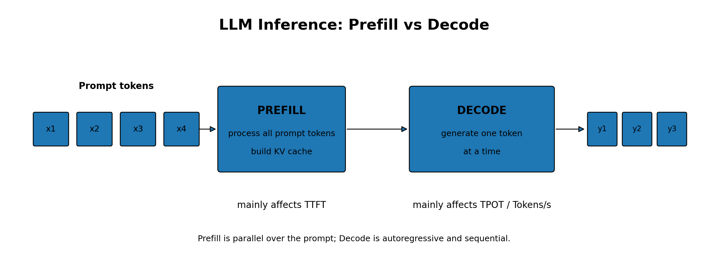
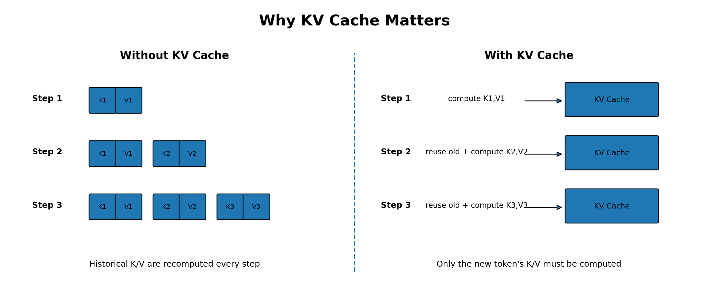
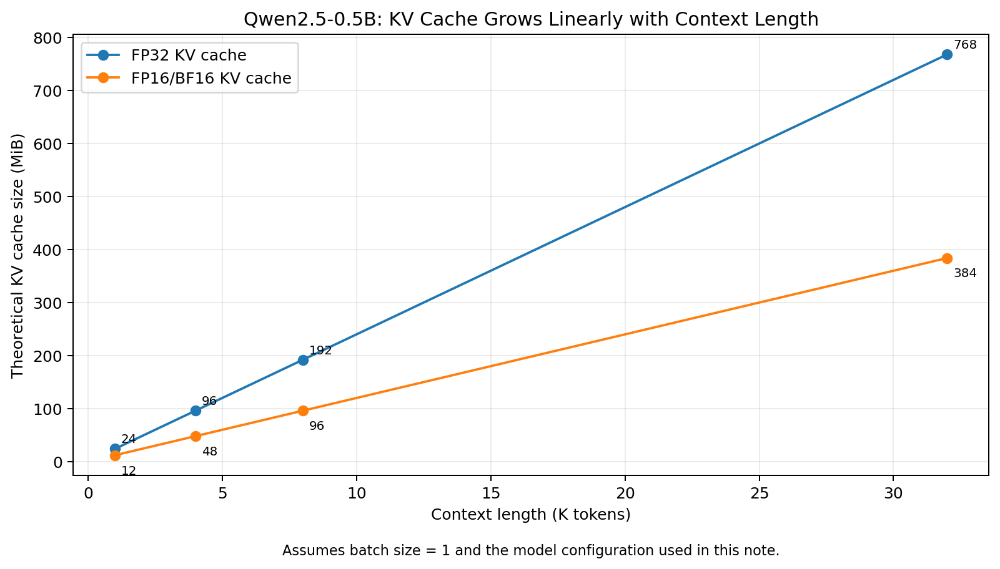
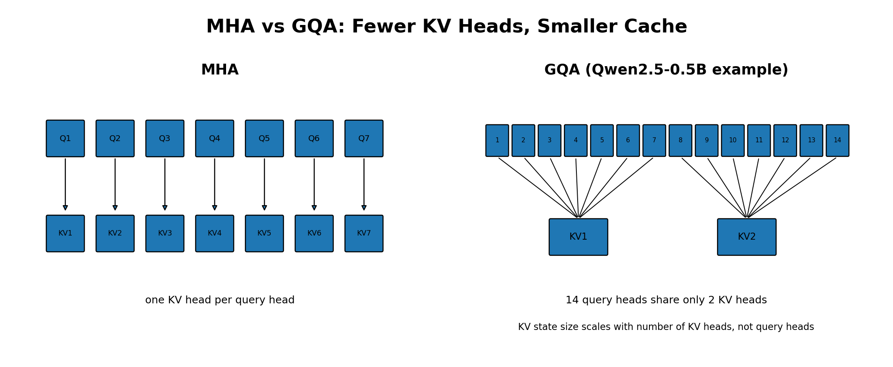
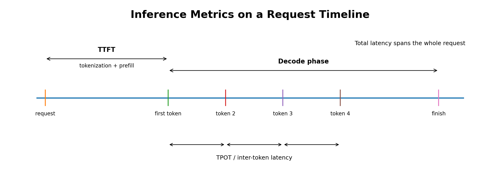

# Efficient AI 02：Transformer 推理机制与 KV Cache

> **系列：** Efficient AI 基础　｜　**实践项目：** ResearchPulse  
> **关键词：** Autoregressive Decoding · Prefill · Decode · Attention · KV Cache · GQA · TTFT · TPOT
> **时间：**  2026.10

第一篇解决的是“如何运行并测量一个本地 LLM”。这一篇继续往下一层：**一次 `model.generate()` 内部究竟发生了什么，以及为什么 KV Cache 会直接影响推理速度和内存。**

---

## 1. 推理不是一次前向传播

因果语言模型（Causal LM）生成文本时采用自回归方式：

\[
P(x_{1:T})=\prod_{t=1}^{T}P(x_t\mid x_{<t})
\]

模型每次只预测下一个 Token。生成第 \(t\) 个 Token 时，需要依赖之前的上下文 \(x_{<t}\)。

因此，一次文本生成通常包含两个阶段：

```text
Prompt tokens
     │
     ▼
┌───────────────┐
│    Prefill    │  一次处理整个输入
└───────┬───────┘
        │  建立 KV Cache
        ▼
┌───────────────┐
│    Decode     │  每次生成 1 个 Token
│ token by token│
└───────┬───────┘
        │
        ▼
Generated text
```

### Prefill

Prefill 一次性处理完整 Prompt。

例如输入长度为 500 Tokens，模型会并行处理这 500 个 Token，并在每一层 Attention 中得到对应的 Key 和 Value。

Prefill 的特点：

- 输入 Token 可以并行计算；
- 计算量随输入长度增长明显；
- 主要影响 **Time To First Token（TTFT）**；
- 同时建立后续 Decode 所需的 KV Cache。

### Decode

Prefill 完成后，模型开始逐 Token 生成：

```text
token 501
   ↓
token 502
   ↓
token 503
   ↓
...
```

每一步都会执行一次模型前向计算，因此 Decode 本质上是一个串行循环。

Decode 的特点：

- 一次通常只处理一个新 Token；
- 无法像 Prefill 一样在 Token 维度大规模并行；
- 主要影响生成阶段的 **TPOT / Inter-Token Latency**；
- 长输出会直接增加总生成时间。

这也是为什么 LLM 的“输入很长”和“输出很长”会产生不同类型的性能压力。

*图 1　Prefill 负责一次性处理输入并建立 KV Cache；Decode 负责逐 Token 自回归生成。*

---

## 2. Attention 在推理阶段做什么？

Scaled Dot-Product Attention：

\[
\operatorname{Attention}(Q,K,V)
=
\operatorname{softmax}
\left(
\frac{QK^\top}{\sqrt{d_{\text{head}}}}
+
M
\right)V
\]

其中：

- \(Q\)：Query
- \(K\)：Key
- \(V\)：Value
- \(M\)：Causal Mask
- \(d_{\text{head}}\)：单个 Attention Head 的维度

对于隐藏状态 \(X\)，模型通过线性映射得到：

\[
Q=XW_Q,\qquad K=XW_K,\qquad V=XW_V
\]

在因果语言模型中，第 \(t\) 个 Token 只能关注当前位置及之前的 Token，不能看到未来 Token。

```text
        K1  K2  K3  K4
Q1      ●
Q2      ●   ●
Q3      ●   ●   ●
Q4      ●   ●   ●   ●
```

---

## 3. 为什么需要 KV Cache？

如果没有缓存，每生成一个新 Token，都需要重复计算历史 Token 的 Key 和 Value。

```text
step 1: K1 V1

step 2: K1 V1
        K2 V2

step 3: K1 V1
        K2 V2
        K3 V3
```

但历史 Token 的 K/V 在后续生成中不会变化，因此可以保存并复用：

\[
K_{\text{cache}}=[k_1,k_2,\ldots,k_{t-1}]
\]

\[
V_{\text{cache}}=[v_1,v_2,\ldots,v_{t-1}]
\]

生成第 \(t\) 个 Token 时，只计算当前 Token 的 \(q_t,k_t,v_t\)，然后：

\[
\operatorname{Attention}
\left(
q_t,
[K_{\text{cache}},k_t],
[V_{\text{cache}},v_t]
\right)
\]

随后追加当前 K/V：

\[
K_{\text{cache}}
\leftarrow
\operatorname{concat}(K_{\text{cache}},k_t)
\]

\[
V_{\text{cache}}
\leftarrow
\operatorname{concat}(V_{\text{cache}},v_t)
\]

**KV Cache 本质上是在用内存换计算。**

*图 2　没有 KV Cache 时历史 K/V 会被重复计算；启用缓存后只需计算当前 Token 的 K/V。*

---

## 4. 为什么缓存 K、V，而不是 Q？

生成第 \(t\) 个 Token 时，只需要当前 Token 的 Query：

\[
q_t
\]

当前 Query 会去查询所有历史 Key，并据此读取对应 Value。

```text
current query
     │
     ▼
q_t × [k1 k2 k3 ... kt]
             │
             ▼
      attention weights
             │
             ▼
[v1 v2 v3 ... vt]
```

历史 Query 在对应 Token 被处理后已经完成作用，不需要继续保存；历史 K/V 则会在后续每一步 Decode 中被再次访问。

---

## 5. KV Cache 占多少内存？

忽略额外元数据时：

\[
M_{\text{KV}}
\approx
2
\times
L
\times
T
\times
H_{\text{KV}}
\times
d_{\text{head}}
\times
B
\times
S
\]

| 符号 | 含义 |
|---|---|
| \(2\) | Key + Value |
| \(L\) | Transformer 层数 |
| \(T\) | 序列长度 |
| \(H_{\text{KV}}\) | KV Head 数 |
| \(d_{\text{head}}\) | Head 维度 |
| \(B\) | 每元素字节数 |
| \(S\) | Batch Size |

### Qwen2.5-0.5B-Instruct 示例

官方配置：

```text
num_hidden_layers      = 24
num_attention_heads    = 14
num_key_value_heads    = 2
hidden_size            = 896
```

因此：

\[
d_{\text{head}}=896/14=64
\]

单 Token 需要保存：

\[
2\times24\times2\times64=6144
\]

个数值。

如果 KV Cache 使用 FP32：

\[
6144\times4=24576\text{ Bytes}=24\text{ KiB/token}
\]

如果使用 FP16 / BF16：

\[
6144\times2=12\text{ KiB/token}
\]

理论值如下：

| Context Length | FP32 KV Cache | FP16 / BF16 KV Cache |
|---:|---:|---:|
| 1K | ~24 MiB | ~12 MiB |
| 4K | ~96 MiB | ~48 MiB |
| 8K | ~192 MiB | ~96 MiB |
| 32K | ~768 MiB | ~384 MiB |

这里只计算 KV Tensor 本身，实际进程内存还包括权重、激活、运行时缓存与分配器开销。

*图 3　以 Qwen2.5-0.5B 的配置估算，KV Cache 与 Context Length 近似线性增长。*

---

## 6. GQA：直接减少 KV Cache

Multi-Head Attention（MHA）通常让 Query、Key、Value 拥有相同数量的 Head。

Grouped Query Attention（GQA）则允许多个 Query Head 共享同一组 K/V Head。

```text
Query Heads:
Q1 Q2 Q3 Q4 Q5 Q6 Q7 | Q8 Q9 Q10 Q11 Q12 Q13 Q14
 \  \  \  \  \  \  /     \  \   \   \   \   \   /
         KV1                       KV2
```

`Qwen2.5-0.5B-Instruct` 的配置是：

```text
14 Query Heads
2 KV Heads
```

仅从 KV Head 数量看，相比 14 个 KV Head 的 MHA，KV 状态规模约缩小：

\[
14/2=7
\]

倍。

GQA 的重要价值之一，就是在保留多个 Query Head 的同时降低 KV Cache 存储和内存带宽压力。

*图 4　GQA 让多个 Query Heads 共享较少的 KV Heads，从结构上减少 KV Cache。*

---

## 7. Prefill 与 Decode 的瓶颈不同

### Prefill：更偏计算密集

Prompt 较长时，模型需要一次性处理大量 Token。

```text
大量 Token
    ×
矩阵乘法
    ×
较好的并行性
```

它直接影响：

\[
TTFT=\text{Time To First Token}
\]

### Decode：更偏串行和内存访问

Decode 每次只有一个新 Token，却要经过所有 Transformer Layers，并读取：

- 模型权重；
- 历史 KV Cache；
- 中间状态。

因此 Decode 往往更容易受到：

- 内存带宽；
- KV Cache 访问；
- Kernel / 算子效率；
- CPU/GPU 利用率；

影响。

这也是为什么：

```text
模型参数缩小 4 倍
≠
生成速度提升 4 倍
```

---

## 8. 更有意义的推理指标

### TTFT — Time To First Token

\[
TTFT=t_{\text{first token}}-t_{\text{request}}
\]

主要反映 Tokenization、Prefill 与调度开销。

### TPOT — Time Per Output Token

\[
TPOT
\approx
\frac{
t_{\text{finish}}-t_{\text{first token}}
}{
N_{\text{output}}-1
}
\]

反映连续生成阶段每个 Token 的平均耗时。

### Tokens/s

\[
\text{Tokens/s}
=
\frac{N_{\text{generated}}}
{t_{\text{generation}}}
\]

比较时至少应注明：

- Prompt 长度；
- Output Token 数；
- 是否包含 Prefill；
- 是否包含 Tokenization；
- Batch Size。


*图 5　TTFT 描述首 Token 响应，TPOT 描述连续生成阶段，总延迟覆盖完整请求。*

### End-to-End Latency

\[
T_{\text{total}}
=
T_{\text{tokenize}}
+
T_{\text{prefill}}
+
T_{\text{decode}}
+
T_{\text{postprocess}}
\]

---

## 9. Transformers 中的 Cache

Hugging Face `generate()` 对支持缓存的自回归模型通常会使用 KV Cache：

```python
outputs = model.generate(
    **inputs,
    max_new_tokens=100,
    use_cache=True,
)
```

当前 Transformers 支持多种缓存策略：

| Cache | 特点 |
|---|---|
| Dynamic Cache | 随 Token 增长，常见默认方式 |
| Static Cache | 预先分配空间，更适合固定形状与编译优化 |
| Offloaded Cache | 将大部分 KV Cache 移到 CPU |
| Quantized Cache | 使用更低精度存储 KV states |

Cache 策略本身也是速度与内存之间的权衡。

---

## 10. 权重量化和 KV Cache 量化的区别

### Weight Quantization

```text
FP32 weights
    ↓
Q8 / INT8
    ↓
Q4 / INT4
```

主要影响：

- 模型文件大小；
- 权重内存；
- 权重读取带宽。

ResearchPulse 当前的 GGUF / llama.cpp 实验属于这一类。

### KV Cache Quantization

对象是运行时产生的 K/V states：

```text
KV FP16
   ↓
KV INT8 / INT4
```

主要针对：

- 长上下文内存；
- 大 Batch 推理；
- KV Cache 带宽。

因此，权重压缩以后，长上下文下的 KV Cache 仍可能成为重要内存来源。

---

## 11. 关于我的项目：ResearchPulse 后续 Benchmark 如何扩展

当前实验路线：

```text
Qwen2.5-0.5B-Instruct
        │
        ├── PyTorch FP32
        │
        └── GGUF / llama.cpp
                 ├── Q8
                 └── Q4
```

后续可以逐步记录：

| 指标 | 作用 |
|---|---|
| Prompt Tokens | 控制输入规模 |
| Output Tokens | 控制输出规模 |
| TTFT | 测 Prefill / 首 Token |
| Tokens/s | 测 Decode |
| Total Latency | 测完整请求 |
| Process RSS | 测运行时内存 |
| Model File Size | 测权重存储 |
| KV Cache Memory | 测长上下文压力 |
| Summary Quality | 检查优化后的质量损失 |

更完整的实验变量：

```text
Model
×
Precision
×
Context Length
×
Output Length
×
Runtime
```

例如：

```text
Qwen2.5-0.5B
FP32 / Q8 / Q4
512 / 2K / 8K context
100 output tokens
PyTorch / llama.cpp
```

这样得到的数据才足以解释某项优化到底改善了什么。

---

## 12. 一个适合动手验证的实验

固定 Prompt 与输出长度，分别运行：

```python
outputs = model.generate(
    **inputs,
    max_new_tokens=100,
    use_cache=True,
)
```

和：

```python
outputs = model.generate(
    **inputs,
    max_new_tokens=100,
    use_cache=False,
)
```

记录：

```text
Latency
Tokens/s
RSS
```

这个实验可以直接观察 KV Cache 对自回归生成的实际作用。

随着 Prompt 和输出长度增加，重复计算历史状态的代价通常会更明显。

---

## 13. 小结

Transformer 推理可以从三层理解：

```text
模型权重
    ├── 参数量
    └── FP32 / FP16 / INT8 / INT4

Attention 状态
    ├── Prefill
    ├── Decode
    └── KV Cache

推理系统
    ├── Kernel / Runtime
    ├── Memory bandwidth
    ├── Cache strategy
    └── Batching / Scheduling
```

KV Cache 的核心思想：

> **历史 Token 的 K/V 已经计算过，就不要在每一步 Decode 中重新计算。**

它减少计算，却增加内存占用。因此现代 LLM 推理优化始终是在：

\[
\text{Compute}
\quad\leftrightarrow\quad
\text{Memory}
\quad\leftrightarrow\quad
\text{Latency}
\]

之间寻找平衡。

对 ResearchPulse 来说，理解这一层后，FP32、Q8、Q4 的 Benchmark 就不再只局限于速度数字，而可以继续追问：

- 权重压缩后，Decode 为什么会变快或不变？
- 长上下文时，KV Cache 占用了多少内存？
- GQA 带来了多少 KV Cache 节省？
- 量化后的摘要质量是否仍然可接受？

我也希望通过对 ResearchPulse 这个项目的自行构建，实现认知上的"走向"理解推理系统”的一步。

---

## 参考资料

1. Hugging Face Transformers — How caching works  
   https://huggingface.co/docs/transformers/main/cache_explanation

2. Hugging Face Transformers — Cache strategies  
   https://huggingface.co/docs/transformers/main/en/kv_cache

3. Hugging Face Transformers — Generation  
   https://huggingface.co/docs/transformers/main_classes/text_generation

4. PyTorch — Scaled Dot Product Attention  
   https://docs.pytorch.org/docs/main/generated/torch.nn.functional.scaled_dot_product_attention.html

5. Qwen Team — Qwen2 Technical Report  
   https://arxiv.org/abs/2407.10671

6. Qwen — Qwen2.5-0.5B-Instruct config.json  
   https://huggingface.co/Qwen/Qwen2.5-0.5B-Instruct/blob/main/config.json
